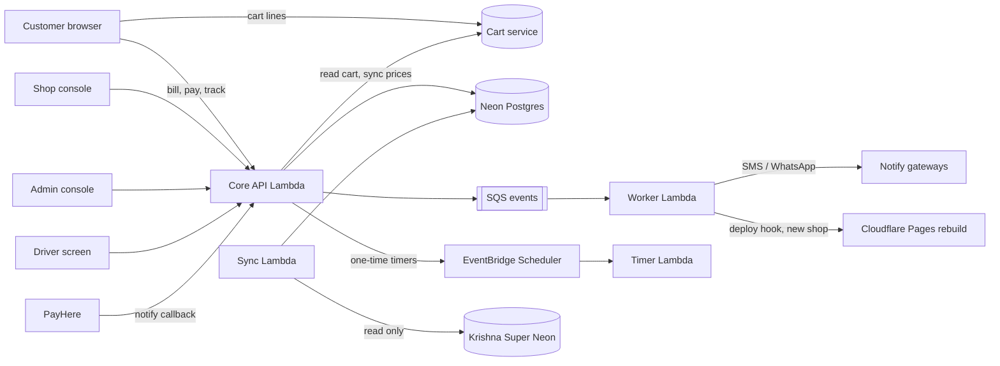

# Grocery Platform — Specification Set

A multi-shop online grocery platform for Sri Lanka.
Customers pick **one shop**, fill a cart, submit a **bill**, the shop **checks it by hand**, then the customer **pays** and the shop **delivers** in a **time slot**.

- Working name: set by `PLATFORM_NAME` (idea: **NearShop**, `nearshop.lk`, not bought yet).
- First shop: **Krishna Super** (Dangedara). Its catalog comes from its own Neon database.
- Stack: Go on AWS Lambda (SAM), Neon Postgres, the existing cart service, Next.js (static export, client pages) on Cloudflare Pages, R2 for images.
- Style: simple, light, Airbnb-like UI. Security first: **never trust the client**.

---

## 1. Reading order

| # | File | What it answers |
|---|---|---|
| 00 | [docs/00-decisions.md](docs/00-decisions.md) | Every important decision and why. Read first. |
| 01 | [docs/01-srs-actors.md](docs/01-srs-actors.md) | Who uses the system and what each person can do (use cases). |
| 02 | [docs/02-srs-features.md](docs/02-srs-features.md) | Numbered requirements (FR / NFR) per feature. |
| 03 | [docs/03-order-flow.md](docs/03-order-flow.md) | Order states, allowed moves, timers, sequence diagrams. |
| 04 | [docs/04-architecture.md](docs/04-architecture.md) | System parts, AWS resources, request paths, cost. |
| 05 | [docs/05-data-model.md](docs/05-data-model.md) | Tables, ERD, money rules, row-level security. |
| 06 | [docs/06-api.md](docs/06-api.md) | Every HTTP endpoint, inputs, outputs, errors. |
| 07 | [docs/07-backend-design.md](docs/07-backend-design.md) | Go modules, shared helpers, events, timers, pricing engine. |
| 08 | [docs/08-frontend-design.md](docs/08-frontend-design.md) | Components, pages, design tokens, API-call rules. |
| 09 | [docs/09-integrations.md](docs/09-integrations.md) | Cart service, PayHere, SMS / WhatsApp, Google, Neon connector. |
| 10 | [docs/10-security.md](docs/10-security.md) | Threat model and security controls. |
| 11 | [docs/11-security-audit.md](docs/11-security-audit.md) | Vulnerability checklist (XSS, CSRF, SSRF, IDOR …) with tests and tools. |
| 12 | [docs/12-file-structure.md](docs/12-file-structure.md) | Monorepo tree and what lives where. |
| 13 | [docs/13-config.md](docs/13-config.md) | Environment variables and secrets. |
| 14 | [docs/14-deployment.md](docs/14-deployment.md) | Environments, SAM, Cloudflare, CI/CD, go-live checklist. |
| 15 | [docs/15-testing.md](docs/15-testing.md) | Test strategy and the must-pass test list. |
| 16 | [docs/16-roadmap.md](docs/16-roadmap.md) | Phases and what "done" means. |

**Machine-readable contracts** (single source of truth):

| File | Purpose |
|---|---|
| [contracts/enums.json](contracts/enums.json) | All roles, statuses and option values. Go and TypeScript files are **generated** from it. |
| [contracts/schema.sql](contracts/schema.sql) | The full Postgres schema (tested on real Postgres 16; Neon runs 16/17). |
| [.env.example](.env.example) / [web/.env.example](web/.env.example) | Every config value with safe placeholders. |

**For Claude Code:**

| File | Purpose |
|---|---|
| [CLAUDE.md](CLAUDE.md) | Short, strict rules for the coding agent. |
| [PROMPTS.md](PROMPTS.md) | Numbered build prompts, one small step each, with checks. |

---

## 2. The whole system in one picture

## 3. Rules that never change

1. **Prices, fees, discounts and totals are calculated on the server only.**
2. **One shop per bill.** A cart belongs to one shop.
3. **The shop checks every bill by hand before the customer can pay.**
4. **Paid is set only by a verified PayHere callback** (or an admin for manual bank transfer).
5. **After payment the customer cannot cancel.** Only an admin can approve a cancel or refund.
6. **Every shop-owned row carries `shop_id`.** Every query is scoped. Row-level security is the safety net.
7. **Money is `int64` cents** (`Rs 450.50` → `45050`). No floats anywhere.
8. **Enums come from `contracts/enums.json` only.** Never type a status string by hand.
9. **Platform name and domains come from env variables.** No hard-coded brand.
10. **The web app is a Next.js static export.** Screens are `"use client"` and talk to the Go API. No Server Actions, API routes or middleware. Shop pages are pre-built and rebuilt by a webhook when a shop is added (D30); prices always load live.

## 4. Open questions (not blocking)

These have a safe default in the docs. Change the default when you decide.

| # | Question | Default used |
|---|---|---|
| Q1 | Final platform name and domain | `PLATFORM_NAME=NearShop`, `PLATFORM_DOMAIN=nearshop.lk` |
| Q2 | Which SMS provider | Generic HTTP SMS adapter. Pick a local provider later. |
| Q3 | Does Krishna Super's product table have an `updated_at` column? | If yes: incremental sync. If no: full sync with row hashes. |
| Q4 | Cart service plan limit `maxItems` for Krishna Super | Must be raised above the shop's product count before go-live. |
| Q5 | Drivers' sign-in | Google sign-in, invited by email (same as staff). |
