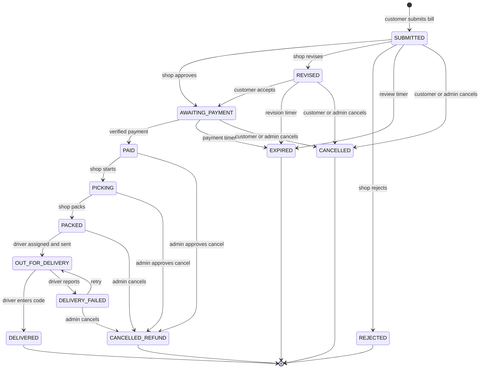
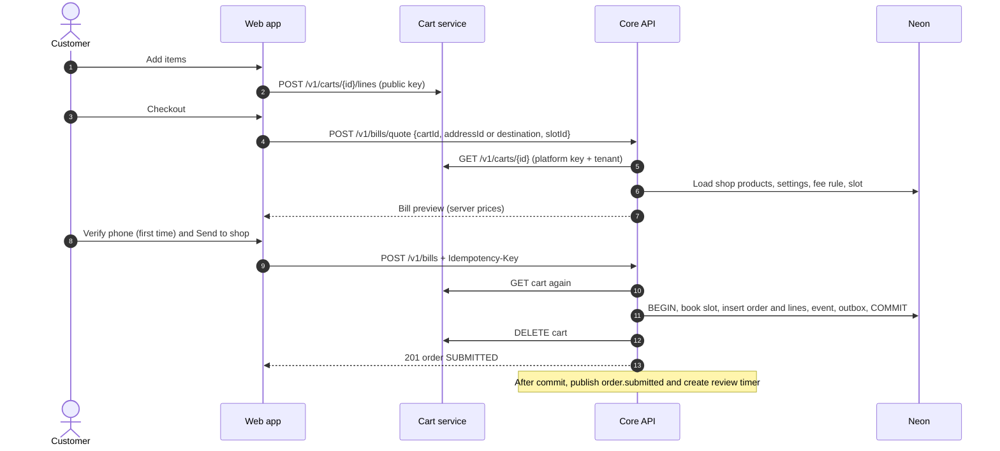
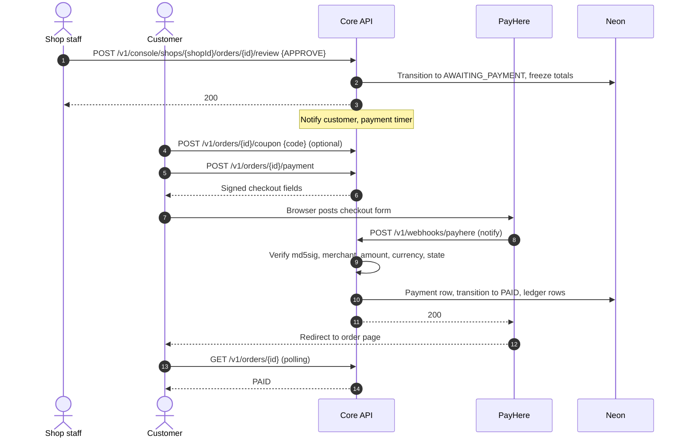
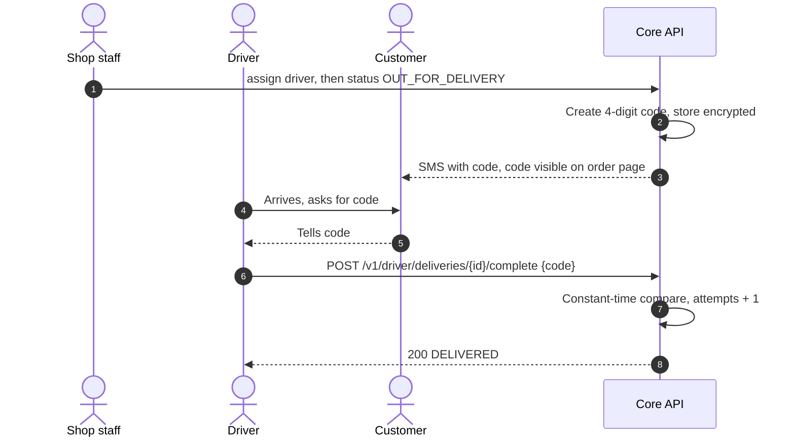

# 03 — Order flow

The order is the heart of the system. This file is the **only** place that defines states and moves.
The same transition list is in `contracts/enums.json` → `order_transitions`, and the code is generated from it.

## 1. States

| State | Meaning | Final? |
|---|---|---|
| `SUBMITTED` | Customer sent the bill. Waiting for the shop. Slot held. | |
| `REVISED` | Shop changed the bill. Waiting for the customer to accept. | |
| `AWAITING_PAYMENT` | Bill approved. Prices frozen. Waiting for payment. | |
| `PAID` | Payment verified. Shop can start. | |
| `PICKING` | Staff collecting items. | |
| `PACKED` | Bags ready. Waiting for a driver. | |
| `OUT_FOR_DELIVERY` | With the driver. Delivery code active. | |
| `DELIVERY_FAILED` | Driver could not deliver. Waiting for retry or cancel. | |
| `DELIVERED` | Customer gave the right code. | ✅ |
| `REJECTED` | Shop refused the bill. | ✅ |
| `EXPIRED` | A timer ran out (review, revision or payment). | ✅ |
| `CANCELLED` | Customer cancelled **before** payment. | ✅ |
| `CANCELLED_REFUND` | Cancelled **after** payment by admin. Refund record exists. | ✅ |

## 2. State diagram

## 3. Transition table

`Actor` = who may do it. The API also checks **scope** (same shop, own order, assigned driver).

| # | From | To | Actor | Conditions | Side effects (same transaction unless noted) |
|---|---|---|---|---|---|
| T01 | — | `SUBMITTED` | Customer | All bill checks pass (`FR-BILL-03`) | Book slot, write order + lines, event `order.submitted`, schedule **review timer** (after commit), delete cart (after commit) |
| T02 | `SUBMITTED` | `AWAITING_PAYMENT` | Owner, Staff, Admin | — | Freeze totals, schedule **payment timer**, event `order.approved` |
| T03 | `SUBMITTED` | `REVISED` | Owner, Staff, Admin | At least one line changed | Save revision, `revision_no + 1`, schedule **revision timer**, event `order.revised` |
| T04 | `SUBMITTED` | `REJECTED` | Owner, Staff, Admin | Reason required | Release slot, event `order.rejected` |
| T05 | `SUBMITTED` | `EXPIRED` | Timer | Review timer fired and state still `SUBMITTED` | Release slot, event `order.expired` |
| T06 | `SUBMITTED` | `CANCELLED` | Customer, Admin | Own order (customer) · reason (admin) | Release slot, event `order.cancelled` |
| T07 | `REVISED` | `AWAITING_PAYMENT` | Customer | `revision_no` in request matches | Freeze totals, schedule payment timer, event `order.approved` |
| T08 | `REVISED` | `EXPIRED` | Timer | — | Release slot, event `order.expired` |
| T09 | `REVISED` | `CANCELLED` | Customer, Admin | Reason (admin) | Release slot, event `order.cancelled` |
| T10 | `AWAITING_PAYMENT` | `PAID` | PayHere callback, Admin (manual mode) | Callback verified **or** admin + reference | Payment row, ledger rows, coupon redemption confirmed, event `order.paid` |
| T11 | `AWAITING_PAYMENT` | `EXPIRED` | Timer | — | Release slot and coupon, event `order.expired` |
| T12 | `AWAITING_PAYMENT` | `CANCELLED` | Customer, Admin | Reason (admin) | Release slot and coupon, event `order.cancelled` |
| T13 | `PAID` | `PICKING` | Owner, Staff | — | event `order.status_changed` |
| T14 | `PICKING` | `PACKED` | Owner, Staff | — | event `order.status_changed` |
| T15 | `PACKED` | `OUT_FOR_DELIVERY` | Owner, Staff, Admin | Driver assigned and allowed by `driver_source` | New delivery code (encrypted), attempts = 0, event `order.out_for_delivery` |
| T16 | `OUT_FOR_DELIVERY` | `DELIVERED` | Assigned driver (code) · Admin (override + reason) | Code matches, not locked | Event `order.delivered` → stats, buy-again |
| T17 | `OUT_FOR_DELIVERY` | `DELIVERY_FAILED` | Assigned driver, Admin | Reason required | Event `order.delivery_failed` |
| T18 | `DELIVERY_FAILED` | `OUT_FOR_DELIVERY` | Owner, Staff, Admin | — | New code, event `order.out_for_delivery` |
| T19 | `PAID`, `PICKING`, `PACKED`, `DELIVERY_FAILED` | `CANCELLED_REFUND` | Admin | Reason required | Refund record `APPROVED`, release slot, event `order.cancelled_refund` |

**Not a transition, but related:**

| Action | Allowed in | Who | Result |
|---|---|---|---|
| Request full cancel | `PAID`, `PICKING` | Owner, Staff | Refund request `REQUESTED`, type `FULL` |
| Request partial refund | `PICKING` | Owner, Staff | Refund request `REQUESTED`, type `PARTIAL`, line marked missing |
| Apply / remove coupon | `AWAITING_PAYMENT` | Customer | Totals recalculated, use reserved / released |
| Assign driver | `PAID` … `PACKED`, `DELIVERY_FAILED` | Owner, Staff, Admin | `driver_id` set |
| Unlock delivery code | `OUT_FOR_DELIVERY` | Admin | Attempts reset |
| Report a problem | `PAID` and later | Customer | Support ticket for admin |

## 4. Rules for every transition

1. Load the order with `version`. Check the transition is in the table **for this actor**.
2. Update with `WHERE id = $1 AND version = $2`. No row updated → `409 STALE_ORDER`.
3. Write an `order_events` row (from, to, actor, role, reason).
4. Write an `outbox` row for the event.
5. Commit. Then publish to SQS and create / delete schedules.
6. Timer handlers **never trust the timer**. They re-read the order and do nothing if the state moved on.

All of this lives in **one function**: `order.Transition(ctx, scope, orderID, to, input)`. Handlers never update `status` directly.

## 5. Timers

| Timer | Starts at | Default | Setting | On fire |
|---|---|---|---|---|
| Review | T01 | 15 min | `review_timeout_min` | If `SUBMITTED` → T05 |
| Revision | T03 | 15 min | `revision_timeout_min` | If `REVISED` → T08 |
| Payment | T02 / T07 | 30 min | `payment_timeout_min` | If `AWAITING_PAYMENT` → T11 |

- Schedule name: `ord-<orderId>-<kind>-<revisionNo>`. Unique, so a repeat call does not make two.
- Schedules delete themselves after running (`ActionAfterCompletion: DELETE`).
- If creating a schedule fails, the outbox sweep retries it.

## 6. Money freezing

| Moment | What is calculated | Stored |
|---|---|---|
| Quote | Everything, live | Nothing |
| Submit (T01) | Everything, live | Lines with prices, fees, totals (not final) |
| Revise (T03) | Lines changed, fees recalculated | New totals, old lines kept for "before / after" |
| Approve (T02 / T07) | **Final** totals | `frozen_at` set. No price change after this. |
| Coupon | Discount on frozen items total | `discount_cents`, `total_cents` updated |
| Paid (T10) | Nothing new | Ledger rows from frozen numbers |

## 7. Sequence: browse → bill submitted

## 8. Sequence: shop review → payment

## 9. Sequence: delivery with code

## 10. Slot lifecycle

| Event | Slot change |
|---|---|
| T01 submit | `booked + 1` (atomic, fails if full or past cutoff) |
| T03 revise with new slot | Book new slot, then release old (same transaction) |
| T04, T05, T06, T08, T09, T11, T12, T19 | `booked − 1` |
| Admin lowers capacity below `booked` | Allowed. Slot shows "full". Existing orders stay. |

## 11. Coupon lifecycle

| Event | Coupon change |
|---|---|
| Apply | `used_count + 1 WHERE used_count < usage_limit` and per-user check → reservation row |
| Remove / T11 / T12 | `used_count − 1`, reservation deleted |
| T10 paid | Reservation becomes final (`confirmed_at`) |
| T19 after payment | Stays used (money already discounted). Refund amount is what the customer paid. |
