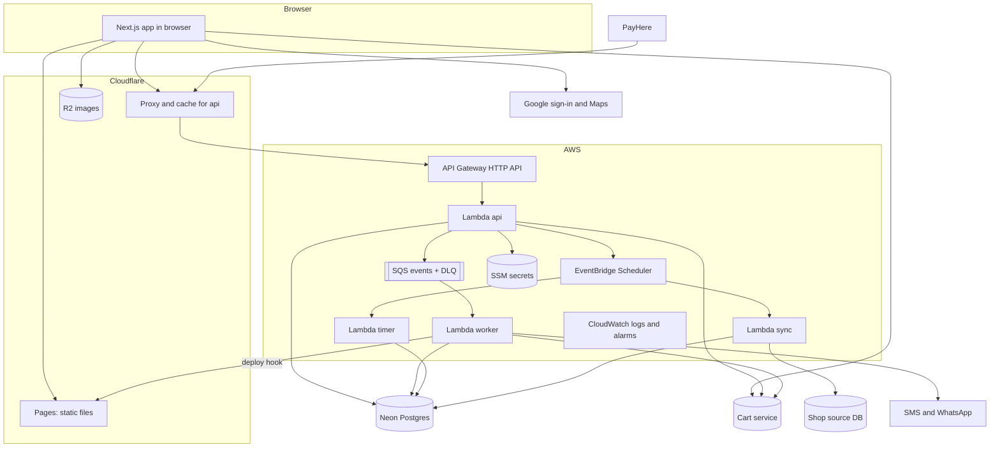

# 04 — Architecture

## 1. Parts

| Part | Tech | Hosted on | Domain |
|---|---|---|---|
| Web app (customer + console) | Next.js App Router, static export, client pages | Cloudflare Pages | `www.<PLATFORM_DOMAIN>` |
| Core API | Go, one Lambda (`api`) | AWS API Gateway HTTP API, proxied by Cloudflare | `api.<PLATFORM_DOMAIN>` |
| Worker | Go Lambda (`worker`) | SQS trigger | — |
| Site rebuild | Cloudflare Pages deploy hook | called by `worker` | — |
| Timer | Go Lambda (`timer`) | EventBridge Scheduler target | — |
| Sync | Go Lambda (`sync`) | EventBridge schedule + async invoke | — |
| Core database | Postgres 17 | Neon (free plan) | — |
| Cart service | Existing Go service | AWS (its own stack) | its own domain |
| Images | Object storage | Cloudflare R2 public bucket | `img.<PLATFORM_DOMAIN>` |
| Secrets | SSM Parameter Store `SecureString` | AWS | — |

All Go functions are built from **one** module (`backend/`). They share every package. Only `cmd/<name>/main.go` differs.

## 2. Diagram



## 3. What each function does

| Function | Trigger | Does | Timeout | Memory | Reserved concurrency |
|---|---|---|---|---|---|
| `api` | HTTP | All routes in `06-api.md` | 10 s | 256 MB | 20 |
| `worker` | SQS (batch 10, partial batch response) | Notifications, stats, buy-again, cart price push, outbox sweep | 30 s | 256 MB | 5 |
| `timer` | Scheduler one-time schedule | Review / revision / payment timeouts | 10 s | 128 MB | 5 |
| `sync` | Scheduler (every `interval_min`, open hours), async invoke (trigger / "Sync now") | Read shop DB, write catalog | 60 s | 256 MB | 2 |

**Why reserved concurrency:** Neon's pooler has a connection limit. Max total = 20 + 5 + 5 + 2 = 32 Lambda instances × 2 pool connections = 64, inside the pooler limit.

## 4. Request paths and API call budget

| Screen | Calls | Notes |
|---|---|---|
| Any first load | `GET /v1/bootstrap` | Platform config + signed-in user + roles. Cached in memory for the session. |
| Home | `GET /v1/home?lat=&lng=` | Shops, lowest prices, promos in **one** response. Cached 60 s at Cloudflare (no user data in it). |
| Search | `GET /v1/search?q=&shop=` | Debounced 300 ms, min 2 characters. |
| Shop page | `GET /v1/shops/{slug}` + `GET /v1/shops/{slug}/products?category=` | Second call per category, cached in the browser by TanStack Query. |
| Add to cart | Cart service only | No core API call. |
| Bill page | `POST /v1/bills/quote` once, again only when address or slot changes | |
| Submit | `POST /v1/bills` | |
| Order page | `GET /v1/orders/{id}` every 20 s while visible and active | Stops at final states. |
| Console order list | `GET /v1/console/shops/{id}/orders?status=` every 20 s while visible | Returns `ETag`. Unchanged → `304`, tiny response. |

## 5. Events

Events are written to `outbox` in the business transaction, then sent to SQS.

| Event | Producer | Consumers in `worker` |
|---|---|---|
| `order.submitted` | T01 | notify shop, stats |
| `order.approved` | T02, T07 | notify customer, stats (review time) |
| `order.revised` | T03 | notify customer, stats (review time) |
| `order.rejected` | T04 | notify customer, stats |
| `order.expired` | T05, T08, T11 | notify customer + shop, stats |
| `order.cancelled` | T06, T09, T12 | notify shop, stats |
| `order.paid` | T10 | notify shop, stats |
| `order.status_changed` | T13, T14 | stats (pick time) |
| `order.out_for_delivery` | T15, T18 | notify customer with code |
| `order.delivered` | T16 | notify customer, stats, buy-again |
| `order.delivery_failed` | T17 | notify shop |
| `order.cancelled_refund` | T19 | notify customer + shop, stats |
| `refund.requested` | shop request, late payment | notify admin |
| `catalog.changed` | price / availability change | push to cart service price list |
| `connector.failed` | 3 failed runs | notify admin |
| `site.rebuild` | shop created, or slug / name / logo / status changed | call Cloudflare Pages deploy hook (coalesced, D30) |

**Message shape** (same for all):

```json
{ "id": "evt_…", "type": "order.paid", "shopId": "…", "entityId": "…", "at": "2026-11-02T08:15:00Z", "data": {} }
```

- Consumers are **idempotent**: they store processed event ids in `processed_events` (kept 7 days).
- Failures retry 3 times, then go to the **DLQ**. Alarm when DLQ is not empty.

## 6. Timers and schedules

| Schedule | Type | Target |
|---|---|---|
| `ord-<id>-review-<n>` / `-revision-<n>` / `-payment-<n>` | One-time `at(...)`, deletes itself | `timer` |
| `sync-<connectorId>` | `rate(<interval_min> minutes)` with the handler skipping outside open hours | `sync` |
| `outbox-sweep` | `cron(0/15 2-16 * * ? *)` UTC (07:30–22:00 Colombo) | `worker` (direct invoke with `{"type":"outbox.sweep"}`) |
| `stats-rollup` | `cron(45 18 * * ? *)` UTC (00:15 Colombo) | `worker` — deletes what is past its retention (docs/05 section 7). The day's numbers need no closing: each event is added once. |

**Neon rule:** nothing wakes the database more often than every 10 minutes when no one is using the site.

## 7. Data stores and what lives where

| Data | Store | Why |
|---|---|---|
| Users, shops, catalog, orders, payments, ledger, stats | Neon | Relational, transactions, RLS |
| Cart lines | Cart service (DynamoDB) | Already built, fast, works before sign-in |
| Images | R2 | Cheap, no egress fee |
| Connection strings, PayHere secrets, SMS keys, JWT keys, encryption key | SSM `SecureString` | Encrypted at rest, IAM controlled, free (standard tier) |
| Rate-limit counters | Neon tables (`otp_codes`, `rate_counters`) | Only touched on sensitive actions, not on every request |

## 8. Environments

| Env | Web | API | DB | PayHere | SMS |
|---|---|---|---|---|---|
| `dev` | `dev.<domain>` (Pages preview) | `api-dev.<domain>` | Neon branch `dev` | Sandbox | Log only (no real SMS) |
| `prod` | `www.<domain>` | `api.<domain>` | Neon `main` | Sandbox → Live | Real |

Same SAM template, `Env` parameter. Secrets under `/<app>/<env>/…`.

## 9. Failure modes

| Failure | What users see | What the system does |
|---|---|---|
| Neon cold start (sleeping) | First call ~1 s slower | Nothing. Normal. |
| Cart service down | "Can't update cart, try again" | Browsing works. Bill quote fails with `CART_UNAVAILABLE`. |
| SQS publish fails after commit | Nothing | Outbox sweep re-sends within 15 min. |
| Scheduler create fails | Nothing | Outbox sweep re-creates missing timers for open orders. |
| PayHere callback late | Order shows "Confirming payment…" | Page keeps polling. Callback arrives → `PAID`. |
| PayHere callback never comes | Stays `AWAITING_PAYMENT` → `EXPIRED` | If money was taken, PayHere statement → admin uses manual mark-paid / refund. |
| Shop DB down | Prices stay at last good sync | Run logged as failed. 3 in a row → admin alert. |
| SMS provider down | No SMS | Logged `FAILED`. Customer still sees code on the order page. |

## 10. Monthly cost (phase 1 estimate)

Check every price before go-live — free tiers change.

| Item | Expected |
|---|---|
| Lambda, SQS, Scheduler, API Gateway HTTP API | Free tier or a few cents |
| CloudWatch logs (14-day retention) | < USD 1 |
| SSM standard parameters | Free |
| Neon free plan | USD 0 |
| Cloudflare Pages, R2 (≤ 10 GB), proxy | USD 0 |
| Domain `.lk` | Yearly fee |
| **Not free:** SMS, WhatsApp, PayHere % per payment, Google Maps above free credit | Pay per use |

Guards: AWS Budget alert at USD 5, CloudWatch log retention 14 days, **no VPC, no NAT gateway**, no provisioned concurrency.
