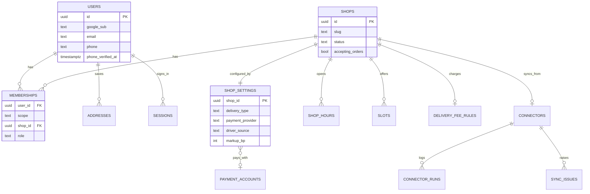
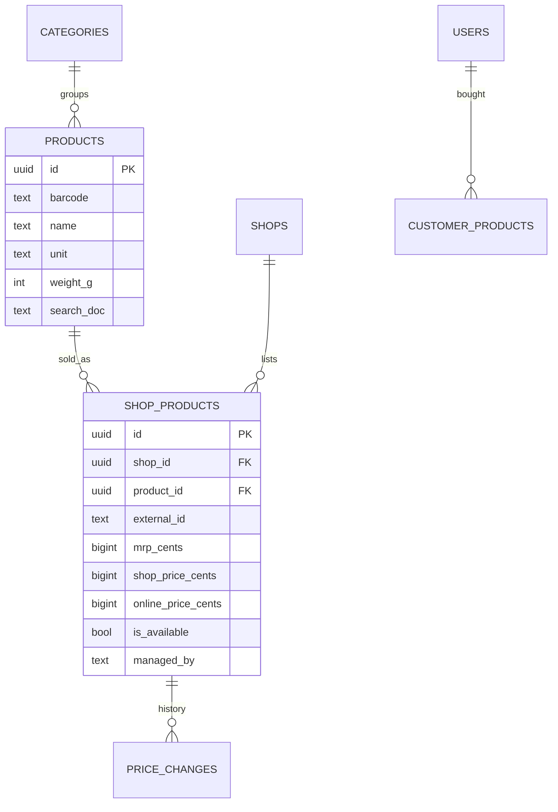
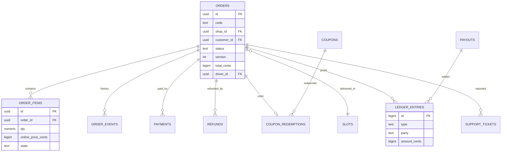

# 05 — Data model

- The full schema is **`contracts/schema.sql`**. This file explains it.
- The schema was run on real Postgres (16) with **`contracts/schema_test.sql`**: 30 security and constraint tests, all passing.
- Migrations: `backend/migrations/0001_init.sql` is a copy of `schema.sql`. New changes go in new numbered files (`0002_…sql`). Tool: `goose` (embedded in the `api` binary as `migrate` command).

## 1. Money and numbers

| Rule | Example |
|---|---|
| Money is `bigint` cents | `Rs 1,435.00` → `143500` |
| Percent is basis points (`int`) | `2.5%` → `250` |
| Quantity is `numeric(10,3)` | `1.250` kg |
| Distance in metres, weight in grams (`int`) | `3200`, `5000` |
| Coordinates `numeric(9,6)` inside Sri Lanka box | lat 5.8–10.0, lng 79.4–82.0 |
| Rupee rounding | Online prices round **half up to the nearest rupee** (100 cents) |

## 2. Main entities (ERD)

### 2.1 People, shops and settings



### 2.2 Catalog



### 2.3 Orders and money



## 3. Table guide

| Table | Purpose | Written by | Notes |
|---|---|---|---|
| `users` | Everyone who signs in | auth | Customer role is implicit. |
| `memberships` | Extra roles: admin, owner, staff, drivers | auth (invite accept), team | One row per user + shop + role. |
| `invites` | Pending invites | team, admin | Token stored as SHA-256 hash. |
| `sessions` | Refresh tokens | auth | Hash only. `family_id` for reuse detection. `totp_ok` for admin. |
| `admin_totp` | Admin TOTP secret | auth | Encrypted with `APP_ENC_KEY`. `last_used_step` blocks replay. |
| `otp_codes` | Phone verification codes | auth | Code hash (HMAC with pepper), 10 min, 5 attempts. |
| `rate_counters` | Fixed-window counters | ratelimit | Only for OTP, coupon tries, code tries, connector trigger. |
| `addresses` | Customer addresses | user | Max 5. One default. |
| `shops` | Shop profile | admin | Starts `DRAFT`, not accepting. |
| `shop_settings` | All per-shop options | admin | One row per shop. |
| `payment_accounts` | PayHere / manual accounts | admin | `secret_ref` = SSM name. Platform account has `shop_id NULL`. `public_info` holds `{ "bank": { bankName, accountName, accountNumber, branch } }` for `MANUAL` accounts. |
| `shop_hours` | Weekly hours (Colombo time) | admin | No row = closed that day. |
| `delivery_fee_rules` | Fee rule | admin | `shop_id NULL` = platform default. |
| `slots` | Delivery windows | admin | `booked` changes only through the booking query. |
| `categories`, `products` | Master catalog | admin, sync | `search_doc` generated for search. |
| `category_markups` | Optional markup per category per shop | admin | Overrides shop markup. |
| `shop_products` | A product in a shop with prices | admin, shop, sync | `online_price_cents` always set by the pricing engine, never taken from a request. Fields the connector owns (`managed_by = CONNECTOR`) are read-only for people. Stock is a whole number in phase 1. |
| `price_changes` | Price history | pricing | Append-only. The first row of a product has no old prices. `source` is `MANUAL`, `CONNECTOR` or `MARKUP` (a markup change). `changed_by` is empty for system jobs. |
| `connectors`, `connector_runs`, `sync_issues` | Shop database sync | admin, sync | Admin-only (RLS). |
| `coupons`, `coupon_redemptions` | Coupons and their use | admin, order | `used_count` changes only through the reserve / release queries. |
| `orders` | One bill / order | order | `version` for optimistic locking. Address is a snapshot. |
| `order_items` | Lines | order | Old lines kept on revision (`state = REMOVED`, `revision_no`). |
| `order_events` | Status history | order | Append-only. Used for the timeline. |
| `payments` | Payment attempts and results | payment | Unique `(provider, provider_ref)` = idempotent callback. |
| `refunds` | Refund requests and results | refund | Admin decides. |
| `support_tickets` | Customer problem reports | order | Admin queue. |
| `ledger_entries` | Money movements | finance | Append-only (trigger + no UPDATE/DELETE grant). |
| `payouts` | Payments to shops | finance | `PAID` needs a bank reference. |
| `customer_products` | Buy-again history | worker | No prices stored. |
| `notifications` | Sent messages log | worker | Phone masked. |
| `shop_daily_stats` | Dashboard numbers | stats (worker) | One row per shop per Colombo day. `platform_income_cents` = margin + service fee; `shop_items_cents` = items less margin; `gmv_cents` is gross at payment. |
| `audit_log` | Who changed what | all modules | Append-only. Shops can write, only admin can read. |
| `outbox`, `processed_events` | Reliable events | all / worker | See `07-backend-design.md`. |
| `idempotency_keys` | Safe retries of POSTs | api (`shared/idem`): claimed in the same transaction as the work | Answers retries for 24 h; the sweep deletes rows older than 7 days. |

## 4. Ledger rules

Written in the same transaction as the status change.

**On `PAID` (T10)** — for a shop paid through the **platform** PayHere account:

| Type | Party | Amount |
|---|---|---|
| `SALE` | SHOP | + Σ (shop_price × qty) of active lines |
| `PLATFORM_MARGIN` | PLATFORM | + Σ (online_price − shop_price) × qty |
| `SERVICE_FEE` | PLATFORM | + service fee |
| `DISCOUNT` | funder (`PLATFORM` or `SHOP`) | − discount |

**On `DELIVERED` (T16):**

| Type | Party | Amount |
|---|---|---|
| `DELIVERY_FEE` | `SHOP` if a shop driver delivered, else `PLATFORM` | + delivery fee |

**On refund `PAID_OUT`:** `REFUND` rows that reverse the matching parts (shop part and platform part, in proportion to what each received).

**On payout `PAID`:** `PAYOUT` row, party `SHOP`, − amount.

Rows of 0 are not written. Rows are posted by `finance` in the transaction of the move that causes them; nothing else writes to `ledger_entries`.

**Check (must always hold for a delivered order):**
`SALE + PLATFORM_MARGIN + SERVICE_FEE + DELIVERY_FEE + DISCOUNT rows = total_cents`

**Shop balance due** = Σ `amount_cents` where `party = SHOP` for that shop.

> Shops on their **own** PayHere account (`owner_type = SHOP`) are phase 3. Then the shop holds the money and owes the platform its part. The same ledger works; only the payout direction flips.

## 5. Row-level security

The API always filters by scope in its queries. RLS is the **second lock**: if a query forgets a filter, Postgres still hides other people's rows.

**How the context is set** — at the start of every transaction, one helper does:

```sql
SELECT set_config('app.user_id',   $1, true),
       set_config('app.shop_id',   $2, true),
       set_config('app.privileged', $3, true);
```

| Request type | `app.user_id` | `app.shop_id` | `app.privileged` |
|---|---|---|---|
| Public (no login) | empty | empty | empty |
| Customer | user id | empty | empty |
| Console, shop route (membership checked first) | user id | that shop id | empty |
| Driver | user id | empty | empty |
| Super admin (TOTP passed) | user id | empty | `on` |
| Worker, timer, sync, PayHere callback, auth module | empty | empty | `on` |

**What each scope can see** (tested in `schema_test.sql`):

| Table group | Customer | Shop scope | Driver | Privileged |
|---|---|---|---|---|
| `users` | self | own customers (via orders) + own team | self + customers of assigned orders | all |
| `orders` and children | own | own shop | assigned | all |
| `addresses`, `customer_products`, `coupon_redemptions` | own | — | — | all |
| `ledger_entries`, `payouts`, `shop_daily_stats` | — | own shop | — | all |
| `connectors`, `payment_accounts`, `sessions`, `otp_codes`, `invites`, `notifications` | — | — | — | all |
| `audit_log` | insert only | insert only | insert only | read + insert |
| Catalog, shops, slots, coupons table | read (public) | read | read | all |

**Setup in Neon:**
1. Neon console → create role `app_rw` (gives LOGIN + password).
2. Run migrations as the owner role (`neondb_owner`).
3. The Lambda `DATABASE_URL` uses **`app_rw`** and the **pooled** host (`-pooler`).
4. Never connect the app as the owner: the owner skips RLS.

## 6. Indexes that matter

| Index | Used by |
|---|---|
| `products_search` (GIN trigram) | Search: `$q <% search_doc` with `pg_trgm.word_similarity_threshold = 0.4` |
| `shop_products_product_price` | Lowest price across shops |
| `orders_shop_status` | Console order lists |
| `orders_customer`, `orders_driver` | Customer orders, driver list |
| `connector_runs_one_running` (partial unique) | Stops overlapping syncs |
| `sync_issues_one_open` (partial unique) | No duplicate open issues |
| `outbox_unsent` (partial) | Outbox sweep |

## 7. Data retention

| Data | Keep |
|---|---|
| Orders, payments, ledger, refunds, audit log | 7 years (finance) |
| Sessions (revoked / expired) | 30 days, then delete |
| `otp_codes`, `rate_counters`, `idempotency_keys`, `processed_events` | 7 days |
| `connector_runs` | 90 days |
| `notifications` | 1 year |
| Deleted user | Name → "Deleted user", email → `deleted+<id>@invalid`, phone removed, addresses deleted. Orders keep the address snapshot with the phone removed. |

Cleanup runs inside the nightly `stats-rollup` job (one DB wake per day).
