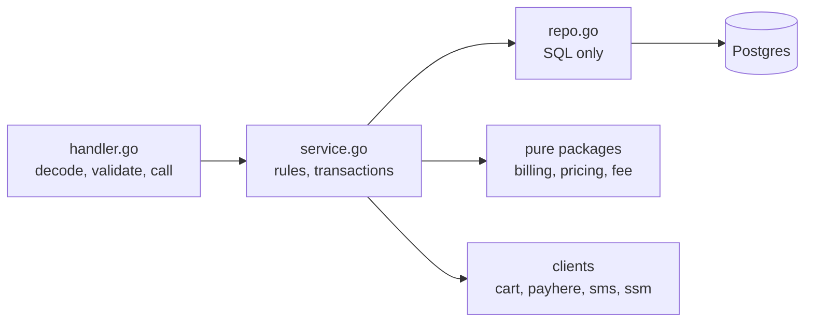
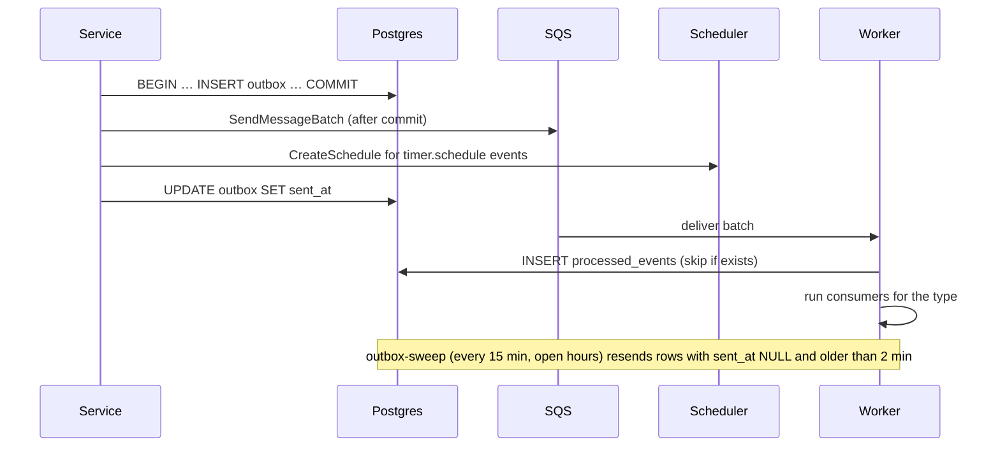
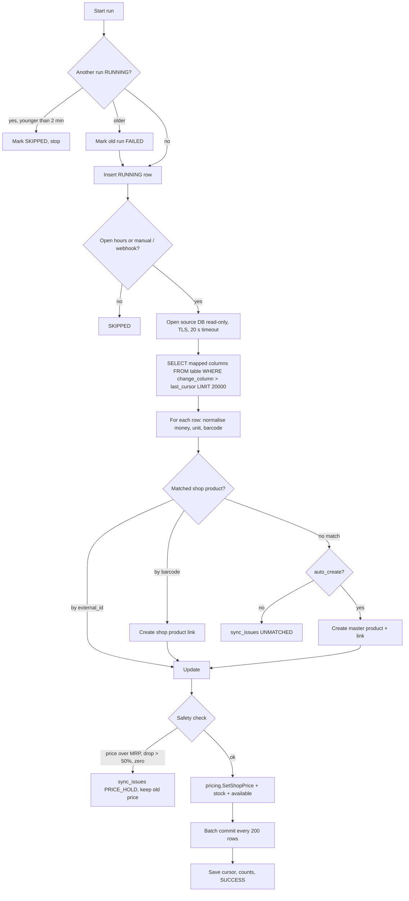

# 07 — Backend design (Go)

Goal: **one way to do each thing.** A coding agent should find the helper, not write a new one.

## 1. Layers



| Layer | May | May not |
|---|---|---|
| `handler.go` | Read request, call `httpx.Decode`, check permission with `authz`, call **one** service method, write response | SQL, business rules, calling other modules' repos |
| `service.go` | Business rules, open a transaction with `db.Tx`, call own repo and other modules' **services** | Read HTTP request, write SQL |
| `repo.go` | SQL with `pgx`, map rows | Business rules, open transactions |
| Pure packages (`billing`, `pricing`, `delivery/fee`) | Math on plain structs | Any I/O. They must be 100% unit-testable. |

## 2. Shared helpers — use these, never re-write them

| Need | Use | File |
|---|---|---|
| Read config at start-up | `config.Load()` | `internal/shared/config` |
| Get a secret | `secrets.Getter.Get(ctx, name)`; the `*secrets.Client` is built once at start-up and passed in (cached 5 min) | `internal/shared/secrets` |
| Run SQL in a transaction with scope | `database.Tx(ctx, scope, fn)` (`*db.DB` is created once at start-up with `db.Connect` and passed in; `fn` gets a `*db.Tx`) | `internal/shared/db` |
| Run work after commit | `tx.AfterCommit(fn)` | `internal/shared/db` |
| Return an error | `apperr.New(apperr.SlotFull)`, `apperr.Validation(fields)` | `internal/shared/apperr` |
| Decode JSON body | `httpx.Decode(r, &in)` (64 KB, unknown fields rejected) | `internal/shared/httpx` |
| Write JSON / error | `httpx.JSON(w, 200, v)`, `httpx.Error(w, r, err)` | `internal/shared/httpx` |
| Validate fields | `validate.New().Str("name", v, 1, 80).Phone(...).Err()` | `internal/shared/validate` |
| Who is calling | `authn.Actor(ctx)` | `internal/shared/authn` |
| Check permission + scope | `authz.Require(ctx, authz.OrderReview, shopID)` | `internal/shared/authz` |
| Money math | `money.Cents`, `money.RoundRupee`, `money.ApplyBP`, `money.MulQty` | `internal/shared/money` |
| Distance | `geo.HaversineM(a, b)` | `internal/shared/geo` |
| Time / Colombo time | `clock.Now()`, `clock.Colombo(t)` | `internal/shared/clock` |
| IDs | `ids.Event()`, `ids.OrderCode(shopPrefix)`, `ids.Token()` | `internal/shared/ids` |
| Encrypt / hash secrets | `crypt.Seal`, `crypt.Open`, `crypt.HMAC`, `crypt.Equal` | `internal/shared/crypt` |
| Rate limit | `ratelimit.Hit(ctx, q, key, limit, window)` | `internal/shared/ratelimit` |
| Emit an event | `events.Add(tx, events.OrderPaid, shopID, orderID, data)` | `internal/events` |
| Create a timer | `events.Add(tx, events.TimerSchedule, …)` (same outbox path) | `internal/events` |
| Write audit row | `audit.Write(tx, actor, "shop.settings", "shop", id, before, after)` | `internal/audit` |
| Log | `logx.From(ctx).Info("…", "orderId", id)` (redacts phones, tokens) | `internal/shared/logx` |
| Enum values | `enum.OrderStatusPaid` etc. (generated) | `internal/shared/enum` |

## 3. Request pipeline

```
requestID → recover → accessLog → bodyLimit → corsAndCsrf → authn (optional) → route guard → handler
```

| Step | Does |
|---|---|
| `requestID` | Sets `X-Request-Id` (ULID). |
| `recover` | Panic → `500 INTERNAL`, logs stack. |
| `accessLog` | Method, route pattern (not raw path), status, ms. No body, no query string values. |
| `bodyLimit` | 64 KB (16 KB on webhooks). |
| `corsAndCsrf` | Exact origin match from `ALLOWED_ORIGINS`. Non-GET needs `X-Requested-With: gp-web` + allowed `Origin`. Webhook routes skip this. |
| `authn` | Reads `gp_at` cookie, verifies HS256 JWT (alg pinned, `iss`, `aud`, `exp`). Puts `Actor{UserID, Roles, TotpOK}` in context. Missing cookie = anonymous. |
| Route guard | `public`, `user`, `perm:<name>` (needs `{shopId}` in path for shop permissions), `admin` (SUPER_ADMIN + `TotpOK`), `sig`. |

**Scope** is built by the guard and passed to services:

```go
type Scope struct {
    UserID     uuid.UUID // zero for system
    ShopID     uuid.UUID // set only on console shop routes after membership check
    Privileged bool      // super admin (TOTP ok) or system jobs
    Role       enum.Role // role used for this request (for audit and transitions)
}
```

`db.Tx` sets `app.user_id`, `app.shop_id`, `app.privileged` from the scope (see `05-data-model.md` §5). **There is no other way to open a transaction.**

## 4. Modules

| Module | Owns tables | Main service functions |
|---|---|---|
| `auth` | users (create), sessions, admin_totp, invites (accept) | `SignInGoogle`, `Refresh`, `Logout`, `TotpSetup`, `TotpVerify` |
| `user` | users (profile), addresses, otp_codes | `UpdateMe`, `SendPhoneOTP`, `VerifyPhone`, `Addresses*`, `DeleteMe` |
| `team` | memberships, invites | `Invite`, `ChangeRole`, `Remove`, `ListTeam` |
| `shop` | shops, shop_settings, shop_hours, payment_accounts | `Create`, `UpdateSettings`, `SetHours`, `SetAccepting`, `Readiness`, `CanTakeOrders` |
| `catalog` | categories, products, shop_products (reads), customer_products | `Home`, `Search`, `ShopPage`, `Products`, `BuyAgain` |
| `pricing` | shop_products (price columns), price_changes, category_markups | `SetShopPrice`, `Reprice(shopID)`, `OnlinePrice` (pure) |
| `delivery` | slots, delivery_fee_rules | `Slots`, `Book`, `Release`, `Fee` (pure), `CopyWeek` |
| `billing` | — (pure) | `Build(BillInput) (Bill, error)` |
| `coupon` | coupons, coupon_redemptions | `Apply`, `Remove`, `ReleaseFor(order)`, `ConfirmFor(order)` |
| `order` | orders, order_items, order_events, support_tickets | `Quote`, `Submit`, `Review`, `Transition`, `Detail`, `AllowedActions` |
| `payment` | payments, payment_accounts (read) | `Start`, `HandlePayHereNotify`, `MarkPaidManual` |
| `refund` | refunds | `Request`, `Decide`, `MarkPaidOut` |
| `finance` | ledger_entries, payouts | `PostPaid`, `PostDelivered`, `PostRefund`, `CreatePayout`, `MarkPayoutPaid`, `Balance` |
| `notify` | notifications | `Send(ctx, msg)` → provider by channel |
| `stats` | shop_daily_stats | `Apply(event)`, `ShopDashboard`, `AdminDashboard`, `DriverStats` |
| `connector` | connectors, connector_runs, sync_issues | `Save`, `Test`, `Tables`, `Columns`, `SetMapping`, `Preview`, `Run`, `ResolveIssue` |
| `cartclient` | — | `GetCart`, `DeleteCart`, `UpsertItems`, `CreateTenant` |
| `events` | outbox, processed_events | `Add`, `PublishAfterCommit`, `Sweep`, `Dispatch` |
| `upload` | — | `Presign` |
| `site` | — | `OnRebuild` (worker consumer: coalesce, then call the Pages deploy hook) |
| `audit` | audit_log | `Write`, `List` |

**Cross-module rule:** a module calls another module's **service**, never its repo. Exception: pure packages can be called by anyone.

## 5. Generated code (`make gen`)

| Source | Generated Go | Generated TS |
|---|---|---|
| `contracts/enums.json` → `enums` | `internal/shared/enum/enum_gen.go` (typed string constants + `Valid()`) | `web/src/lib/enums.gen.ts` |
| `role_permissions`, `conditional_permissions` | `internal/shared/authz/perm_gen.go` | `web/src/lib/perms.gen.ts` (UI hints only) |
| `order_transitions`, `final_order_statuses` | `internal/order/flow_gen.go` | — (UI uses `allowedActions` from API) |
| `error_codes` | `internal/shared/apperr/codes_gen.go` | `web/src/lib/errors.gen.ts` |

Generator: `backend/cmd/gen/main.go` (stdlib only). `make check-contracts` also checks every `CHECK (x IN (...))` list in `schema.sql` matches `enums.json`.

## 6. Pricing engine (pure)

```go
// OnlinePrice returns the customer price in cents.
func OnlinePrice(shopPrice money.Cents, mrp *money.Cents, markupBP int) (money.Cents, error)
```

1. `raw = shopPrice × (10000 + markupBP) / 10000`, rounded half up to the cent.
2. `price = RoundRupee(raw)` (half up to 100 cents).
3. If `mrp != nil` and `price > mrp` → `price = mrp`.
4. If `price < shopPrice` → error `ErrMRPBelowShopPrice` (data problem → sync hold).

Markup used = `category_markups` for the product's category, else `shop_settings.markup_bp`.

**Example:** shop price Rs 1,400.00, MRP Rs 1,500.00, markup 250 bp → raw 143,500 → Rs 1,435.00 (under MRP) → margin Rs 35.00.

`pricing.SetShopPrice` and `pricing.Reprice` always: update `online_price_cents` in the same transaction, write `price_changes`, add `catalog.changed` event.

## 7. Delivery fee (pure)

```go
func Fee(rule Rule, distanceM int, weightG int, itemsCents money.Cents) (money.Cents, error)
```

1. `km = distanceM × road_factor / 1000`. If `km > max_km` → `apperr.OutOfRange`.
2. If `free_above_cents` set and `itemsCents ≥ free_above_cents` → fee `0`.
3. `fee = base + ceil(max(0, km − free_km)) × per_km + ceil(max(0, kg − free_kg)) × per_kg`.
4. Clamp to `[min_cents, max_cents]`.

**Example:** base Rs 100, per km Rs 30 after 2 km, per kg Rs 10 after 5 kg, straight line 2.0 km × 1.3 = 2.6 km, 7.5 kg → `100 + ceil(0.6)×30 + ceil(2.5)×10 = 100 + 30 + 30 = Rs 160`.

`distanceM` = haversine(shop, address). `weightG` = Σ (`product.weight_g` or category default) × qty.

## 8. Bill builder (pure, one function for every money calculation)

```go
type BillInput struct {
    Shop       ShopSnapshot          // settings, location, min order, markup
    Lines      []LineInput           // shopProductID, qty, subPref
    Products   map[uuid.UUID]ShopProductSnapshot
    Address    Point
    FeeRule    delivery.Rule
    Coupon     *CouponSnapshot       // nil before AWAITING_PAYMENT
    UserCouponUses int
    Now        time.Time
}
func Build(in BillInput) (Bill, error)
```

Used by: quote, submit, revise, accept revision, coupon apply / remove. **No other code adds up money.**

Steps: validate lines (available, qty 1..max_per_order, ≤ `max_lines`) → line totals → items total → service fee (`max(0, min_platform_margin − margin)`) → weight → distance → delivery fee → coupon discount (cap by `max_discount`, by items total, and by platform income unless `allow_loss`) → total → checks (min order).

**Quantities:** phase 1 quantities are whole numbers (packs). `unit` + `size_label` describe the pack. Loose weighed items are phase 3.

## 9. Order service

```go
func (s *Service) Transition(ctx context.Context, sc Scope, orderID uuid.UUID, to enum.OrderStatus, in TransitionInput) (Detail, error)
```

Inside one `db.Tx`:
1. `SELECT … FOR UPDATE` the order.
2. `flow.Allowed(from, to, actorRole)` from generated table, plus scope check (own order / own shop / assigned driver).
3. Check `in.Version == order.version`.
4. Run the **side-effect hook** for this transition (slot release, freeze totals, ledger, code creation…). Hooks are small functions in `order/hooks.go`, keyed by transition id.
5. `UPDATE orders SET status, version = version + 1, <timestamps> WHERE id AND version`.
6. Insert `order_events`, `events.Add(...)`, `audit.Write(...)` for admin overrides.
7. After commit: publish events, create timers.

`Submit`, `Review`, coupon and payment functions all end by calling `Transition` (or the shared hook code) — never their own `UPDATE orders SET status`.

**Order codes:** `<SHOPPREFIX>-<6 chars>` from Crockford base32, e.g. `KS-7Q2M9X`. Prefix from shop slug (2 letters). Unique index retries once on clash.

**Delivery code:** 4 random digits (`crypto/rand`), stored with `crypt.Seal` (AES-256-GCM, key `APP_ENC_KEY`), compared with `crypt.Equal` (constant time).

## 10. Events, outbox and timers



- `events.Dispatch` has a map `type → []consumer`. Adding a consumer is one line.
- Consumers: `notify.OnOrderEvent`, `stats.Apply`, `catalog.OnDelivered` (buy-again), `cartclient.OnCatalogChanged`, `site.OnRebuild`, `finance` (none async — ledger is written in the transaction).
- `site.rebuild` is sent to SQS with a **120 s delay**. When it arrives, the consumer checks `outbox` for a **newer** `site.rebuild` row; if there is one, it skips (that newer event will do the build). So a burst of shop edits makes one rebuild. Then it `POST`s the deploy hook URL from SSM (`pages/deploy-hook`) with a 5 s timeout; failures retry through SQS.
- `timer.schedule` events are **not** sent to SQS; the publisher calls Scheduler `CreateSchedule` with name `ord-<id>-<kind>-<rev>`, `at(…)`, target `timer`, payload `{orderId, kind, revisionNo}`, `ActionAfterCompletion: DELETE`. `ConflictException` = already exists = success.
- Timer handler: `order.Transition(ctx, systemScope, id, EXPIRED, {expectFrom: …, expectRevision: rev})`. Wrong state → no-op, return nil.

## 11. Catalog sync (`connector.Run`)



- Source query is **built from the saved mapping** with `pgx.Identifier{…}.Sanitize()` for every name, after checking each name exists in `information_schema`. No user text ever goes into SQL.
- Without `change_column`: read all rows, compare `sha256(row)` to `shop_products.source_hash`, skip unchanged. Rows missing from the source → `is_available = false`.
- Source connection: `pgx.Connect` (no pool), `sslmode=require` forced, `default_transaction_read_only=on` set in the connection, statement timeout 20 s.
- Host check before connecting: resolve DNS, refuse private, loopback, link-local and metadata addresses (see `11-security-audit.md`, SSRF).

## 12. Payment providers

```go
type Provider interface {
    Checkout(ctx context.Context, acc Account, p Payment, o OrderView) (CheckoutResponse, error)
    // PayHere only: verify and parse a notify call
    ParseNotify(ctx context.Context, acc Account, form url.Values) (NotifyResult, error)
}
```

- `payhere.Provider` and `manual.Provider`. Picked by `shop_settings.payment_provider`.
- Account secret read with `secrets.Get(acc.SecretRef)`.
- Details of the PayHere hash and checks: `09-integrations.md` §2.

## 13. Notifications

```go
type Message struct { To string; Template string; Vars map[string]string; ShopID *uuid.UUID; UserID *uuid.UUID; EventID string }
type Channel interface { Send(ctx context.Context, m Message) (ref string, cost int, err error) }
```

- Channels: `sms` (generic HTTP gateway), `whatsapp` (Cloud API templates), `walink` (no send — stores a `LINK` row; console shows a "Send on WhatsApp" button with a `wa.me` link).
- `dev` env uses `logchannel` (writes masked message to logs).
- Templates live in `internal/notify/templates.go` as a map, max 160 characters for SMS, variables escaped.
- Daily cap check before send: count today's SMS from `notifications`. Over cap → `SKIPPED` + admin alert once.

## 14. Errors and logging

- Services return `*apperr.Error` with a code from `enums.json`. Unknown errors become `INTERNAL` and are logged with the request id.
- Never put user input in error messages returned to the client.
- `logx` redacts keys named `phone`, `email`, `token`, `code`, `secret`, `password`, `authorization`, `cookie` and any value that looks like a phone number.

## 15. Allowed dependencies

Adding anything else needs an entry in `00-decisions.md`.

| Purpose | Module |
|---|---|
| Lambda runtime + HTTP API adapter | `github.com/aws/aws-lambda-go`, `github.com/awslabs/aws-lambda-go-api-proxy` |
| AWS clients | `github.com/aws/aws-sdk-go-v2/...` (ssm, sqs, scheduler, s3 for R2 presign, lambda) |
| Postgres | `github.com/jackc/pgx/v5` |
| Migrations | `github.com/pressly/goose/v3` |
| Google ID token | `github.com/coreos/go-oidc/v3` |
| Our access token | `github.com/golang-jwt/jwt/v5` (HS256 only) |
| TOTP | `github.com/pquerna/otp` |
| IDs | `github.com/google/uuid`, `github.com/oklog/ulid/v2` |
| Routing | standard library `net/http.ServeMux` (Go 1.22+ patterns) |
| Tests | standard library `testing` + a real Postgres in CI |
