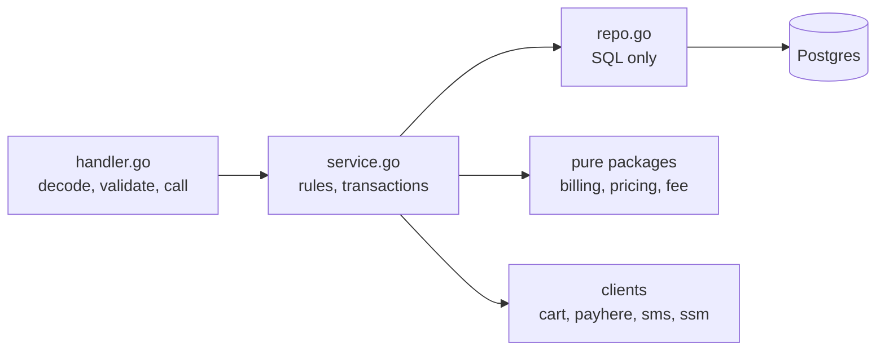
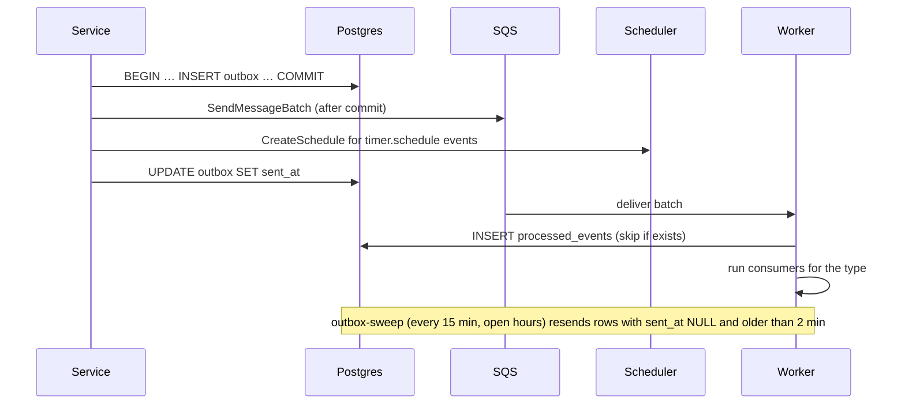
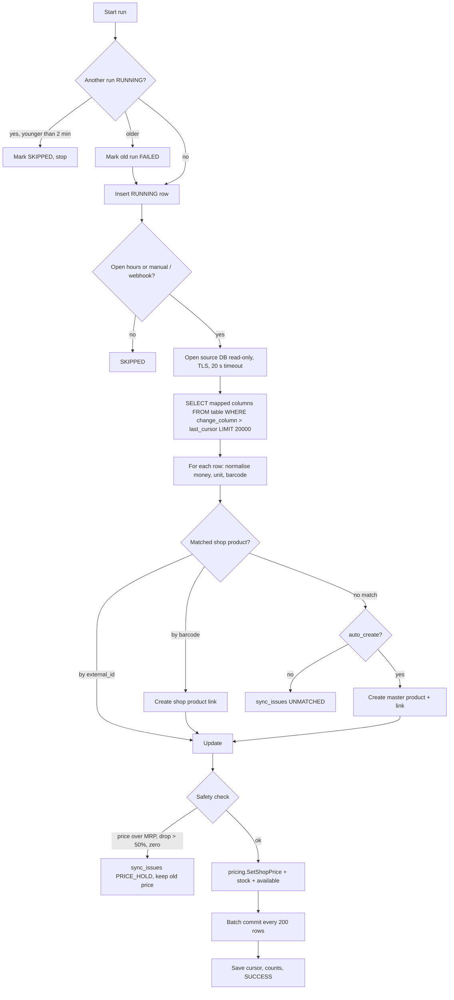

# 07 — Backend design (Go)

Goal: **one way to do each thing.** A coding agent should find the helper, not write a new one.

## 1. Layers



| Layer | May | May not |
|---|---|---|
| `handler.go` | Read request, call `httpx.Decode`, check permission with `authz`, call **one** service method, write response | SQL, business rules, calling other modules' repos |
| `service.go` | Business rules, open a transaction with `db.Tx`, call own repo and other modules' **services** | Read HTTP request, write SQL |
| `repo.go` | SQL with `pgx`, map rows | Business rules, open transactions |
| Pure packages (`billing`, `pricing`, `delivery/fee`) | Math on plain structs | Any I/O. They must be 100% unit-testable. |

## 2. Shared helpers — use these, never re-write them

| Need | Use | File |
|---|---|---|
| Read config at start-up | `config.Load()` | `internal/shared/config` |
| Store a secret (write-only) | `secrets.Putter.Put(ctx, name, value)`; the value is never read back by an API | `internal/shared/secrets` |
| Get a secret | `secrets.Getter.Get(ctx, name)`; the `*secrets.Client` is built once at start-up and passed in (cached 5 min) | `internal/shared/secrets` |
| Run SQL in a transaction with scope | `database.Tx(ctx, scope, fn)` (`*db.DB` is created once at start-up with `db.Connect` and passed in; `fn` gets a `*db.Tx`) | `internal/shared/db` |
| Run work after commit | `tx.AfterCommit(fn)` | `internal/shared/db` |
| Return an error | `apperr.New(apperr.SlotFull)`, `apperr.Validation(fields)` | `internal/shared/apperr` |
| Admin or "me" route steps (scope, `{id}`, body, JSON out, `204` on nil) | `routex.Admin(w, r, 200, withID, &in, run)`, `routex.User(…)` | `internal/shared/routex` |
| Console route steps (scope with the shop from the `perm:` guard) | `routex.Console(w, r, 200, withID, &in, run)`; the shop is `scope.ShopID`, never from the body | `internal/shared/routex` |
| Database error checks | `db.IgnoreNoRows(err)`, `db.IsUniqueViolation(err)`, `db.IsForeignKeyViolation(err)`, `db.IsCheckViolation(err)` | `internal/shared/db` |
| `NOT_FOUND` for a missing row | `apperr.NotFoundUnless(err, found)` | `internal/shared/apperr` |
| PATCH field that can be omitted or `null` | `optional.Field[T]` (`Set`, `Null`, `Ptr()`) | `internal/shared/optional` |
| Decode JSON body | `httpx.Decode(r, &in)` (64 KB, unknown fields rejected) | `internal/shared/httpx` |
| Write JSON / error | `httpx.JSON(w, 200, v)`, `httpx.Error(w, r, err)` | `internal/shared/httpx` |
| Validate fields | `validate.New().Str("name", v, 1, 80).Phone(...).Err()` | `internal/shared/validate` |
| Image URL under our own image host | `validate.New().HTTPSURLUnder("imageUrl", v, cfg.ImgBaseURL, 300)` | `internal/shared/validate` |
| Who is calling | `authn.Actor(ctx)` | `internal/shared/authn` |
| Check permission + scope | `authz.Require(ctx, authz.OrderReview, shopID)` | `internal/shared/authz` |
| Money math | `money.Cents`, `money.RoundRupee`, `money.ApplyBP`, `money.MulQty` | `internal/shared/money` |
| Distance and Sri Lanka box | `geo.HaversineM(a, b)`, `geo.Point.InSriLanka()` | `internal/shared/geo` |
| Time / Colombo time | `clock.Now()`, `clock.Colombo(t)` | `internal/shared/clock` |
| IDs | `ids.Event()`, `ids.OrderCode(shopPrefix)`, `ids.Token()` | `internal/shared/ids` |
| Encrypt / hash secrets | `crypt.Seal`, `crypt.Open`, `crypt.HMAC`, `crypt.Equal` | `internal/shared/crypt` |
| Hash an identifier with a secret key (IP, phone, OTP code) | `pepper.Hash(ctx, sec, pepper.OTP, parts...)` | `internal/shared/pepper` |
| Check a Turnstile token (server side) | `turnstile.Verifier.Verify(ctx, token, ip)` → `BOT_CHECK_FAILED` | `internal/shared/turnstile` |
| Send a message (SMS, later WhatsApp) | `notify.Sender.Send(ctx, notify.Message{To, Template, Vars})`; the text comes from `notify/templates.go` | `internal/notify` |
| Rate limit | `ratelimit.Hit(ctx, db, key, limit, window)`. Runs in its **own committed transaction**, so a refused request still counts. Put a keyed hash in `key`, never an e-mail or raw IP. | `internal/shared/ratelimit` |
| Caller address | `httpx.ClientIP(r)`: for throttling and hashing only, never for access decisions | `internal/shared/httpx` |
| Publish after commit (start-up) | `events.SetPublisher(events.NewPublisher(db, queue, scheduler))` | `internal/events` |
| Emit an event | `events.Add(ctx, tx, events.Event{Type: …, ShopID: …, EntityID: …, Payload: …})` (same tx as the change) | `internal/events` |
| Announce changed shop products | `events.AddCatalogChanged(ctx, tx, shopID, ids)` (ids only, 200 per event) | `internal/events` |
| Create a timer | `events.Add(ctx, tx, events.Event{Type: events.TimerSchedule, …})` (same outbox path) | `internal/events` |
| Write audit row | `audit.Write(ctx, tx, scope, audit.Entry{Action: "shop.settings", Entity: "shop", EntityID: id, ShopID: shopID, Before: b, After: a})` (before / after pass through `logx.RedactSecrets`) | `internal/audit` |
| Log | `logx.From(ctx).Info("…", "orderId", id)` (redacts phones, tokens) | `internal/shared/logx` |
| Enum values | `enum.OrderStatusPaid` etc. (generated) | `internal/shared/enum` |

## 3. Request pipeline

```
requestID → securityHeaders → recover → accessLog → bodyLimit → corsAndCsrf → authn (optional) → route guard → handler
```

| Step | Does |
|---|---|
| `requestID` | Sets `X-Request-Id` (ULID). |
| `securityHeaders` | `nosniff`, HSTS, `Cache-Control: private, no-store` (public routes loosen it with `CachePublic`). |
| `recover` | Panic → `500 INTERNAL`, logs stack. |
| `accessLog` | Method, route pattern (not raw path), status, ms. No body, no query string values. |
| `bodyLimit` | 64 KB (16 KB on webhooks). |
| `corsAndCsrf` | Exact origin match from `ALLOWED_ORIGINS`. Non-GET needs `X-Requested-With: gp-web` + allowed `Origin`. Webhook routes skip this. |
| `authn` | Reads `gp_at` cookie, verifies HS256 JWT (alg pinned, `iss`, `aud`, `exp`). Puts `Actor{UserID, SessionID, TotpOK}` in context. Missing cookie = anonymous. Roles are **not** in the token: a role change must act at once. |
| Route guard | `public`, `user`, `perm:<name>` (needs `{shopId}` in path for shop permissions), `admin` (SUPER_ADMIN + `TotpOK`), `sig`. `perm:` and `admin` load the caller's active memberships from the database on every call (`team.Service.Memberships`) and call `authz.Require` / `authz.RequireAdmin`. The result is stored in the request context: handlers read it with `authz.ScopeFrom(ctx)` and never rebuild it. |

**Scope** is built by the guard and passed to services:

```go
type Scope struct {
    UserID     uuid.UUID // zero for system
    ShopID     uuid.UUID // set only on console shop routes after membership check
    Privileged bool      // super admin (TOTP ok) or system jobs
    Role       enum.Role // role used for this request (for audit and transitions)
}
```

`db.Tx` sets `app.user_id`, `app.shop_id`, `app.privileged` from the scope (see `05-data-model.md` §5). **There is no other way to open a transaction.**

## 4. Modules

| Module | Owns tables | Main service functions |
|---|---|---|
| `auth` | users (create), sessions, admin_totp, invites (accept) | `SignInGoogle`, `Refresh`, `Logout`, `TotpSetup`, `TotpVerify` |
| `user` | users (profile), addresses, otp_codes | `UpdateMe`, `SendPhoneOTP`, `VerifyPhone`, `Addresses*`, `DeleteMe` |
| `team` | memberships, invites | `Invite`, `ChangeRole`, `Remove`, `ListTeam` |
| `shop` | shops, shop_settings, shop_hours, payment_accounts | `Create`, `UpdateSettings`, `SetHours`, `SetAccepting`, `Readiness`, `CanTakeOrders` |
| `catalog` | categories, products, shop_products (reads), customer_products | `Home`, `Search`, `ShopPage`, `PublicProducts`, `CategoryTree`, `BuyAgain` (public); admin and console: `CreateProduct`, `UpdateShopProduct`, … |
| `pricing` | shop_products (price columns), price_changes, category_markups | `SetShopPrice`, `Reprice(shopID)`, `OnlinePrice` (pure) |
| `delivery` | slots, delivery_fee_rules | `Slots`, `Book`, `Release`, `Fee` (pure), `CopyWeek` |
| `billing` | — (pure) | `Build(BillInput) (Bill, error)` |
| `coupon` | coupons, coupon_redemptions | Admin `Create`, `List`, `Update`; for an order `Apply`, `Release(order)`, `Confirm(order)` (the order module's `ApplyCoupon` / `RemoveCoupon` call them) |
| `order` | orders, order_items, order_events, support_tickets | `Quote`, `Submit`, `Review`, `Transition`, `Detail`, `AllowedActions` |
| `payment` | payments, payment_accounts (read) | `Start`, `MarkPaid`, `Verify`, `HandleNotify` |
| `refund` | refunds | `Request`, `Decide`, `MarkPaidOut` |
| `finance` | ledger_entries, payouts | `PostPaid`, `PostDelivered`, `PostRefund`, `CreatePayout`, `MarkPayoutPaid`, `Balance` |
| `notify` | notifications | `Send(ctx, msg)` → provider by channel |
| `stats` | shop_daily_stats | `Apply(event)`, `ShopDashboard`, `AdminDashboard`, `DriverStats` |
| `connector` | connectors, connector_runs, sync_issues | `Save`, `Test`, `Tables`, `Columns`, `SetMapping`, `Preview`, `Run`, `ResolveIssue` |
| `cartclient` | — | `GetCart`, `DeleteCart`, `UpsertItems`, `EnsureTenant`; `ToAppError` maps its errors to `CART_UNAVAILABLE` |
| `events` | outbox, processed_events | `Add`, `PublishAfterCommit`, `Sweep`, `Dispatch` |
| `upload` | — | `Presign` (R2 link signed to content type and length; who may upload is checked in its handler) |
| `site` | — | `OnRebuild` (worker consumer: coalesce, then call the Pages deploy hook) |
| `audit` | audit_log | `Write`, `List` |

**Cross-module rule:** a module calls another module's **service**, never its repo. Exception: pure packages can be called by anyone.

The public catalog pages are built by `catalog` from three service calls inside one `db.Public()` transaction: `shop.Cards` / `shop.PageBySlug` (profile and open-now), `delivery.DeliveringShops` / `delivery.NextSlots` (reach and next slot), and its own product queries. A page is a few statements in one transaction; nothing is cached in the Lambda, because Cloudflare caches the answer (`Cache-Control: public`, see docs/06 section 3).

## 5. Generated code (`make gen`)

| Source | Generated Go | Generated TS |
|---|---|---|
| `contracts/enums.json` → `enums` | `internal/shared/enum/enum_gen.go` (typed string constants + `Valid()`) | `web/src/lib/enums.gen.ts` |
| `role_permissions`, `conditional_permissions` | `internal/shared/authz/perm_gen.go` | `web/src/lib/perms.gen.ts` (UI hints only) |
| `order_transitions`, `final_order_statuses` | `internal/order/flow_gen.go` | — (UI uses `allowedActions` from API) |
| `error_codes` | `internal/shared/apperr/codes_gen.go` | `web/src/lib/errors.gen.ts` |

Generator: `backend/cmd/gen/main.go` (stdlib only). `make check-contracts` also checks every `CHECK (x IN (...))` list in `schema.sql` matches `enums.json`.

## 6. Pricing engine (pure)

```go
// OnlinePrice returns the customer price in cents.
func OnlinePrice(shopPrice money.Cents, mrp *money.Cents, markupBP int) (money.Cents, error)
```

1. `raw = shopPrice × (10000 + markupBP) / 10000`, rounded half up to the cent.
2. `price = RoundRupee(raw)` (half up to 100 cents).
3. If `mrp != nil` and `price > mrp` → `price = mrp`.
4. If `price < shopPrice` → error `ErrMRPBelowShopPrice` (data problem → sync hold).

Markup used = `category_markups` for the product's category, else `shop_settings.markup_bp`.

**Example:** shop price Rs 1,400.00, MRP Rs 1,500.00, markup 250 bp → raw 143,500 → Rs 1,435.00 (under MRP) → margin Rs 35.00.

`pricing.SetShopPrice`, `pricing.AddShopProduct` and `pricing.Reprice` always: update `online_price_cents` in the same transaction, write `price_changes`, add `catalog.changed` event.

| Function | Used by | Notes |
|---|---|---|
| `SetShopPrice(ctx, tx, scope, shopID, shopProductID, price, mrp, source)` | console edit, connector sync | `mrp` is stored as given (`nil` clears it). A shop product of another shop is `NOT_FOUND`. No `price_changes` row when nothing changed. |
| `AddShopProduct(ctx, tx, scope, NewShopProduct)` | admin link, connector create | Inserts the row with its first price. History row has no old price. A second link of the same product is a unique-violation error for the caller to name. |
| `Reprice(ctx, tx, scope, shopID)` | shop settings (when `markup_bp` changes), category markups | All products of the shop, `source = MARKUP`. A product with no valid customer price keeps its old price and is logged. |

The `ErrMRPBelowShopPrice` rule has one edge worth knowing: with a 0 % markup, a shop price that is not a whole rupee and rounds *down* (for example Rs 100.40) has no valid customer price. The API answers `400` with `fields.shopPriceCents = "invalid_price"` (or `mrpCents` when the MRP is the cause).

## 7. Delivery fee (pure)

```go
func Fee(rule Rule, distanceM int, weightG int, itemsCents money.Cents) (money.Cents, error)
```

1. `km = distanceM × road_factor / 1000`. If `km > max_km` → `apperr.OutOfRange`.
2. If `free_above_cents` set and `itemsCents ≥ free_above_cents` → fee `0`.
3. `fee = base + ceil(max(0, km − free_km)) × per_km + ceil(max(0, kg − free_kg)) × per_kg`.
4. Clamp to `[min_cents, max_cents]`.

**Example:** base Rs 100, per km Rs 30 after 2 km, per kg Rs 10 after 5 kg, straight line 2.0 km × 1.3 = 2.6 km, 7.5 kg → `100 + ceil(0.6)×30 + ceil(2.5)×10 = 100 + 30 + 30 = Rs 160`.

`distanceM` = haversine(shop, address). `weightG` = Σ (`product.weight_g` or category default) × qty.

**Rule storage and units.** `delivery.Rule` keeps `freeKm`, `freeKg`, `maxKm` and `roadFactor` as hundredths (`Dec2`), so the formula is integer maths only. A shop uses its own `delivery_fee_rules` row, else the platform default (`Service.RuleFor`); with neither it returns `SHOP_NOT_READY`.

**Slots.** Other modules call `delivery.Book(ctx, tx, shopID, slotID, now)` and `delivery.Release(ctx, tx, slotID)` inside their own transaction. `Book` is one `UPDATE … WHERE booked < capacity AND status = 'OPEN' AND cutoff_at > now`; it returns `SLOT_FULL`, `SLOT_CLOSED` or `NOT_FOUND`. `Release` fails if nothing is booked (a double release is a bug).

## 8. Bill builder (pure, one function for every money calculation)

```go
type BillInput struct {
    Shop       ShopSnapshot          // settings, location, min order, markup
    Lines      []LineInput           // shopProductID, qty, subPref
    Products   map[uuid.UUID]ShopProductSnapshot
    Address    Point
    FeeRule    delivery.Rule
    Coupon     *CouponSnapshot       // nil before AWAITING_PAYMENT
    UserCouponUses int
    Now        time.Time
}
func Build(in BillInput) (Bill, error)
```

Used by: quote, submit, revise, accept revision, coupon apply / remove. **No other code adds up money.**

Steps: validate lines (available, qty 1..max_per_order, ≤ `max_lines`) → line totals → items total → service fee (`max(0, min_platform_margin − margin)`) → weight → distance → delivery fee → coupon discount (cap by `max_discount`, by items total, and by platform income unless `allow_loss`) → total → checks (min order).

### 8.1 How the quote is built (P18)

- `order.Service.Quote` loads the facts and hands them to `billing.Build`. It writes nothing.
- Quantities come from the **cart** (read with `cartclient.GetCart` in the shop's own cart tenant). The request only says what to do when a line is not available (`subPref`). A quantity in the request is refused.
- Prices come from `shop_products` through `catalog.BillProducts`. The price the cart shows only sets `priceChanged`.
- A cart line that is not one of this shop's products (or has no item id) is listed as `excluded`, with no name.
- The shop facts come from `shop.OrderFacts`, the fee rule from `delivery.RuleFor`, the windows from `delivery.OpenSlots`, a chosen slot from `delivery.CheckSlot` (same codes as `Book`, no place taken).
- Reads of the shop (payment readiness reads `payment_accounts`) use the system scope. Nothing of the caller is read there. The address and phone are read in the caller's own scope.
- A cart that is not in the shop's tenant is `CART_WRONG_SHOP`; a missing cart is the same answer. A cart service that cannot be reached, or a shop with no cart tenant, is `CART_UNAVAILABLE`.

**Quantities:** phase 1 quantities are whole numbers (packs). `unit` + `size_label` describe the pack. Loose weighed items are phase 3.

## 9. Order service

```go
func (s *Service) Transition(ctx context.Context, sc Scope, orderID uuid.UUID, to enum.OrderStatus, in TransitionInput) (Detail, error)
```

Inside one `db.Tx`:
1. `SELECT … FOR UPDATE` the order.
2. `flow.Allowed(from, to, actorRole)` from generated table, plus scope check (own order / own shop / assigned driver).
3. Check `in.Version == order.version`.
4. Run the **side-effect hook** for this transition (slot release, freeze totals, ledger, code creation…). Hooks are small functions in `order/hooks.go`, keyed by transition id.
5. `UPDATE orders SET status, version = version + 1, <timestamps> WHERE id AND version`.
6. Insert `order_events`, `events.Add(...)`, `audit.Write(...)` for admin overrides.
7. After commit: publish events, create timers.

**Built in P19:**
- `Transition(ctx, scope, orderID, to, TransitionInput{Version, Reason})` opens the transaction; `transition(ctx, tx, …)` is the same inside a caller's transaction (timers, payment callback). The caller's scope is checked after row level security: an order outside the caller's scope is `NOT_FOUND`.
- Order of the checks: scope → version (`STALE_ORDER`) → the generated table for this actor (`INVALID_TRANSITION`) → reason (`VALIDATION_ERROR`) → hook → `UPDATE … WHERE version` → `order_events` + outbox event → audit row when the actor is `SUPER_ADMIN`.
- `hooks` (in `order/hooks.go`) is a map from transition id to the side effect. **A move with no entry refuses to run**, so a half-built flow can never change an order without its side effects. P19 has T01 (review timer), and the slot release for T04, T05, T06, T08, T09 and T19. Later prompts add the rest.
- The outbox event is chosen by the status the order ends in (`eventFor`).
- The system actor (timers, webhooks) has no screen, so `Transition` returns an empty detail for it.
- T01 is not a call to `Transition` (there is no order yet): `Submit` inserts the order, then runs the same T01 hook and the same `record` step.

**Submit (`POST /bills`):** replay lookup → hourly rate limit → shop facts and cart (outside the transaction) → one transaction in the customer's scope: claim the idempotency key, lock the customer row, price with `billing.Build`, check (phone, open orders, lines, range, minimum), book the slot, insert order and lines, T01 hook and history, save the answer under the key. The cart is deleted after the commit.

**Views (`order/view.go`):** one mapper per viewer (`ViewCustomer`, `ViewConsole`, `ViewDriver`). The driver sees no prices, coupon, payment or timeline; the customer sees no customer block; the console sees the phone masked, in full only while picking. `allowedActions` comes from the transition table plus the viewer (`order/actions.go`).

**Built in P20:**
- `TransitionInput` gained `ExpectRevision` (T07: the revision the customer saw) and `Revise` (T03: the shop's changes). Hooks now take `*orderRow`, so a hook that changes the revision or the slot (T03) leaves the history and the event describing the order as it ends.
- Hooks added: T02 and T07 (`approve`: set `frozen_at`, start the payment timer), T03 (`reviseBill`: see below), T11 and T12 (release the slot and, from P21, the coupon use). A scope that is privileged with a shop in it (an admin on a shop's console path) sees that shop's orders only.
- `Review(ctx, scope, id, ReviewInput)` checks the body fits the action and calls `Transition` to `AWAITING_PAYMENT`, `REVISED` or `REJECTED`. `AcceptRevision` (T07) and `Cancel` (always to `CANCELLED`: T06, T09, T12) do the same for the customer. No route has its own status check: the table refuses `Cancel` from `PAID` on.
- **`reviseBill` (T03):** `planOf` applies the changes to the live lines (state `ACTIVE` or `SUBSTITUTE` of the current revision); `billing.Build` prices the result from today's prices (shop facts from `shop.BillFacts`, which has no readiness check and any scope may read; the products from `catalog.BillProducts`; the fee rule from `delivery.RuleFor`); the lines are copied into revision `n + 1` (`copyRemoved`, `insertLine`); `moveSlot` books the new window before it releases the old; `orders` gets the new totals, `revision_no` and `slot_id`; the revision timer is added with the new revision number. A product that cannot be sold is `ITEM_UNAVAILABLE`, so the customer never gets a bill with a hole in it.
- **Timers:** `Service.Expire(ctx, orderID, kind, revisionNo)` is what `cmd/timer` calls (through `internal/timerjob`). In the system scope it locks the order and moves it to `EXPIRED` (T05, T08 or T11) only if the status is the one that kind waits in and `revision_no` is the timer's; anything else, also an unknown order, returns `false` and no error. A repeated delivery is therefore harmless. `timerjob.Handle` drops a malformed event and returns a real failure so Lambda retries. The timer function is wired with the shop and delivery modules only, and may send events to the queue.
- **Lists:** `GET /console/shops/{shopId}/orders` uses the same keyset paging as the customer list (`Page[T]`, `pageStart`, `pageOf`). Its answer is sent as `httpx.Revalidated`, which `routex` writes with an `ETag` (a hash of the body) and answers `If-None-Match` with `304`.

**Built in P21 (`internal/coupon`):**
- `coupon.Service` owns the `coupons` and `coupon_redemptions` tables: `Create`, `List`, `Update` for the admin, and `Apply`, `Release`, `Confirm` for an order, all inside the caller's transaction. `billing` is the only code that works out a discount; `coupon` only decides whether a use may be taken.
- **Apply** (`order.ApplyCoupon`): rate limit (10 tries an hour, every try counts) → lock the order, check owner, `version` and `AWAITING_PAYMENT` → `coupon.Apply`: normalise the code, read the coupon (unknown, paused or another shop's is `COUPON_INVALID`), **reserve** with `UPDATE coupons SET used_count = used_count + 1 WHERE id = $1 AND status = 'ACTIVE' AND (usage_limit IS NULL OR used_count < usage_limit)` (no row: `COUPON_LIMIT`), count the customer's own uses, call the pricer, insert the redemption (unique per order). The pricer is `billing.WithCoupon(frozen totals, stored platform margin, coupon, uses, now)`: dates, the customer's limit, the minimum, the cap, the items total and the platform income cap (`allow_loss` lifts the last one for platform-funded coupons). The order row gets `coupon_id`, `discount_funded_by`, `discount_cents`, `total_cents` and `version + 1`. Any refusal rolls the whole transaction back, so a refused apply never keeps a use.
- The reserve statement locks the coupon row until the commit. That makes the limit exact (BIZ-03) and also serialises the per-user count, so one customer's two orders cannot both take a single-use coupon.
- **Frozen bill:** the fees and prices of an approved order are never worked out again. `billing.WithCoupon` takes the stored totals and moves only the discount and the total, so a change of the fee rule after approval does not change what the customer pays. Remove is the same call with no coupon.
- **Release:** T11 and T12 (`releaseUnpaid`) give back the slot place and the unconfirmed redemption in one statement (`DELETE … RETURNING` then `used_count - 1`). `Confirm` (called by T10 in P22) sets `confirmed_at`; a confirmed use is never released, also after a refund (T19 only releases the slot).
- Money amounts of a coupon are `int64` cents; a `PERCENT` value is basis points.

**Built in P22 (`internal/payment`, `internal/finance`, `internal/refund`):**
- `payment.Service` has `Start` (customer), `MarkPaid` (admin, manual), `Verify` and `HandleNotify` (PayHere). It never changes an order's status: it calls `order.Service.MarkPaid`, which is `transition` to `PAID` (T10) in the payment's own transaction. The order exposes only what payment needs: `Payable` (the customer's order, version and status checked, row locked), `PayState` (system read of status, version, total) and `MarkPaid`.
- **Providers:** `payment.Provider` (`Checkout`) and `payment.Notifier` (`ParseNotify`) are in `payment`; `payment/payhere` and `payment/manual` implement them and `http/wire.go` builds the `Registry`. `payhere.CheckoutHash` and `payhere.NotifySignature` are the only places that know the MD5 scheme; `cmd/fakepayhere` uses the same functions.
- **Accounts:** `shop.Service.PayAccountOf(shopID)` (the ACTIVE account the settings name, of the provider they name; a MANUAL one needs the feature switch) and `PayAccountByID` give the payment module an account with the secret's *name* (never the secret). `payment_accounts` is for the system scope, so `Start` reads the shop in the customer's scope and the account in a second, system-scope read.
- **Start:** idempotency replay → rate limit → read order (shop, version, status) → read account → one customer-scope transaction: claim the key, lock the order again, insert the `INITIATED` payment, build the checkout, save the answer.
- **Notify:** `check` (fields → payment → account → `ParseNotify`: constant-time signature, then merchant, currency, amount) then, in one system-scope transaction, lock the payment and act on the status code. `provider_ref` (PayHere's `payment_id`) is written once; a second payment with the same reference is a unique violation and a no-op. A `SUCCESS` payment with the same reference is a replay.
- **T10 hook (`order.markPaid`):** reads the frozen numbers of the order, calls `finance.PostPaid` and `coupon.Confirm`. `finance.PostPaid` writes `SALE` (SHOP, items − platform margin), `PLATFORM_MARGIN`, `SERVICE_FEE` (PLATFORM) and `DISCOUNT` (negative, for the funder), leaving out rows of 0. `DELIVERY_FEE` comes with delivery (T16). The rows add up to `total_cents − delivery_fee_cents`.
- **Refunds:** `refund.Service.Open` (system-made `REQUESTED` refund plus the `refund.requested` event) is all that exists of the refund module so far.
- **Manual mode:** `MarkPaid` runs the move first (it checks version, status and the actor), then closes the manual attempts and writes the audit row, all in one transaction.
- **Shared:** `money.Decimal` / `money.ParseDecimal` (the gateway's `1585.00`, strict), `httpx.PeekBody` (read a body in a route guard and leave it for the handler; the connector trigger uses it too).
- **Fake PayHere:** `make fake-payhere PAYMENT=<payment id> AMOUNT=1585.00 [STATUS=2] [TIMES=2] [CARD=1]` posts a signed notify to `localhost:8080` and refuses any other host.

`Submit`, `Review`, coupon and payment functions all end by calling `Transition` (or the shared hook code) — never their own `UPDATE orders SET status`.

**Order codes:** `<SHOPPREFIX>-<6 chars>` from Crockford base32, e.g. `KS-7Q2M9X`. Prefix from shop slug (2 letters). Unique index retries once on clash.

**Delivery code:** 4 random digits (`crypto/rand`), stored with `crypt.Seal` (AES-256-GCM, key `APP_ENC_KEY`), compared with `crypt.Equal` (constant time).

## 10. Events, outbox and timers



- `events.Add` writes the row and registers the publish with `tx.AfterCommit`, so a rolled-back transaction never publishes. The publisher is set once at start-up with `events.SetPublisher` (the API Lambda); without a queue (local runs) rows wait for the sweep.
- `Publisher.Publish` sends timers to Scheduler and everything else to SQS in batches of 10, then sets `sent_at` for the accepted ones. A refused or failed event keeps `sent_at` NULL and counts an attempt.
- `events.Registry` has a map `type → []Consumer`. Adding a consumer is one `On` line (in `internal/worker/wire.go`). A repeated name or an unknown type panics at start-up.
- **Exactly-once claim.** `Registry.Dispatch` runs each consumer in its own transaction that first inserts `(event_id, consumer)` into `processed_events`. A duplicate delivery finds the row and skips; a concurrent duplicate waits on the primary key until the first one commits (then skips) or rolls back (then runs). If the consumer fails, the transaction rolls back, the claim disappears, and the queue retries. The consumer gets that transaction, so its database changes and the claim commit together. External calls (SMS, HTTP) cannot be rolled back: keep them idempotent.
- **Sweep** (`outbox.sweep`, direct invoke): up to 5 rounds of 100 unsent rows older than 2 minutes, oldest first, then deletes `processed_events` older than 7 days.
- Consumers: `notify.OnOrderEvent`, `stats.Apply`, `catalog.OnDelivered` (buy-again), `catalog.CartSync.OnChanged` (cart price list), `site.OnRebuild`, `finance` (none async — ledger is written in the transaction).
- `site.rebuild` is sent to SQS with a **120 s delay**. When it arrives, the consumer (`site.Rebuilder`) checks `outbox` for a **newer** `site.rebuild` row; if there is one, it skips (that newer event will do the build). So a burst of shop edits makes one rebuild. Then it `POST`s the deploy hook URL from SSM (`pages/deploy-hook`, must be `https`) with a 5 s timeout. A failure, or a missing secret, is an error: the queue retries and the DLQ alarm fires. Errors never contain the URL.
- `timer.schedule` events are **not** sent to SQS; the publisher calls Scheduler `CreateSchedule` with name `ord-<id>-<kind>-<rev>`, `at(…)` in UTC, target `timer`, payload `{orderId, kind, revisionNo}`, `ActionAfterCompletion: DELETE`. `ConflictException` = already exists = success. Write one with `events.AddTimer(ctx, tx, shopID, events.Timer{OrderID, Kind, RevisionNo, RunAt})`. A `RunAt` that is already past (or less than 30 s away) is moved to 30 s from now, because Scheduler refuses the past; the timer handler is a no-op when the order has moved on.
- Timer handler: `order.Service.Expire(ctx, id, kind, rev)` locks the order in the system scope, does nothing unless the status and revision are the ones the timer was made for, and then calls the same `transition` as every other move (T05, T08, T11). Wrong state → no-op, return nil.

## 11. Catalog sync (`connector.Run`)



- Source query is **built from the saved mapping** with `pgx.Identifier{…}.Sanitize()` for every name, after checking each name exists in `information_schema`. No user text ever goes into SQL.
- Without `change_column`: read all rows, compare `sha256(row)` to `shop_products.source_hash`, skip unchanged. Rows missing from the source → `is_available = false`.
- Source connection: `pgx.Connect` (no pool), TLS with certificate check, every read in a `READ ONLY` transaction with `SET LOCAL statement_timeout` (set per transaction so it also works through a pooler). See `09-integrations.md` section 5.5.
- Host check before connecting: resolve DNS, refuse private, loopback, link-local and metadata addresses (see `11-security-audit.md`, SSRF).

### 11.1 How the run is built (P17)

- **Code:** `connector.Run(ctx, Job{ConnectorID, Trigger, ExternalIDs})` in `run.go` (begin, finish), `read.go` (read, then batches), `apply.go` (one transaction per 200 rows). `internal/syncjob` + `cmd/sync` receive the job. Matching and holds are the pure `Decide` of `plan.go`, the same code the preview uses.
- **No overlap:** `begin` locks the connector row, ends RUNNING rows older than 2 minutes as `FAILED` (`timed_out`), and refuses to start next to a younger one. The partial unique index `connector_runs_one_running` backs this up. A manual run next to a running one is `CONNECTOR_BUSY` (no row); a scheduled or webhook run is written as `SKIPPED`.
- **Who runs when:** `SCHEDULE` and `WEBHOOK` runs need status `ACTIVE` or `FAILING`; `MANUAL` runs any status once a mapping is saved. Only `SCHEDULE` runs wait for open hours (`shop.OpenAt`, Colombo time), and a scheduled run outside them writes no row, so closed nights do not fill the run list.
- **Incremental:** with a change column the read is `WHERE change >= last_cursor ORDER BY change, external id LIMIT 20001`. The cursor is the newest change time read and moves only after a good run. `>=` re-reads the rows of the last change time on purpose; applying a row twice changes nothing. A run for chosen `externalIds` reads only those rows and never moves the cursor.
- **Full:** no change column. Each row is hashed (`sha256` of the length-prefixed raw values) and skipped when `shop_products.source_hash` is the same. Saving a new mapping clears the hashes. When the whole table was read (not cut at 20,000), connector-managed products missing from it become unavailable and lose their hash, so they return with their row. An empty source hides nothing.
- **Per row:** update the price through `pricing.SetShopPrice` (source `CONNECTOR`), keep the MRP the row does not give, take stock and availability (`stock <= 0` means unavailable). A hold keeps the old price but still takes stock and availability. New products go through `pricing.AddShopProduct` with `managedBy = CONNECTOR`; auto-create makes the master product with `catalog.CreateProductIn`. The row's `category` is read but not used yet: a created master product has no category.
- **Same batch:** two rows with one external id apply once (the last wins); two rows with one barcode link or create that master product once, the other is `UNMATCHED` (`already_linked`).
- **Issues:** one open issue per connector, kind and external id (`sync_issues_one_open`); a repeat refreshes its payload. A row that applies cleanly closes its open issues (`RESOLVED`, no `resolved_by`). An `IGNORED` issue stays quiet until the row's content changes.
- **Failure:** the source failing (`CONNECTOR_TEST_FAILED` inside the run) is `source_failed`, anything else `apply_failed`; neither text holds anything from the shop's database. Each failed run adds 1 to `consecutive_failures`; at 3 an `ACTIVE` connector becomes `FAILING` and one `connector.failed` event is written in the same transaction. A good run resets the count and returns `FAILING` to `ACTIVE`.
- **Schedule:** `Schedules.Upsert/Delete` (EventBridge Scheduler, `connaws`) run after the commit that changes the status or interval, so a failure there leaves the saved state and repeating the call fixes it. "Sync now" and the trigger start the run with an async Lambda invoke (`connaws.Invoker`); without a sync function ARN (local runs) the run happens in the request.
- **Trigger:** `Authenticate` checks, in order, the time window, the `v1=` hex form, the secret from the secret store, the HMAC, and only then the hourly limit. Each signed route has its own verifier (`SigByRoute`); a signed route without one is denied.

## 12. Payment providers

```go
type Provider interface {
    Checkout(ctx context.Context, acc Account, p Payment, o OrderView) (CheckoutResponse, error)
    // PayHere only: verify and parse a notify call
    ParseNotify(ctx context.Context, acc Account, form url.Values) (NotifyResult, error)
}
```

- `payhere.Provider` and `manual.Provider`. Picked by `shop_settings.payment_provider`.
- Account secret read with `secrets.Get(acc.SecretRef)`.
- Details of the PayHere hash and checks: `09-integrations.md` §2.

## 13. Notifications

```go
type Message struct { To string; Template string; Vars map[string]string; ShopID *uuid.UUID; UserID *uuid.UUID; EventID string }
type Channel interface { Send(ctx context.Context, m Message) (ref string, cost int, err error) }
```

- Channels: `sms` (generic HTTP gateway), `whatsapp` (Cloud API templates), `walink` (no send — stores a `LINK` row; console shows a "Send on WhatsApp" button with a `wa.me` link).
- `dev` env uses `logchannel` (writes the template name and a masked number to the log, never the text). Only `APP_ENV=local` also logs the rendered text, so a developer can read an OTP code.
- Templates live in `internal/notify/templates.go` as a map, max 160 characters for SMS, variables escaped.
- Daily cap check before send: count today's SMS from `notifications`. Over cap → `SKIPPED` + admin alert once.

## 14. Errors and logging

- Services return `*apperr.Error` with a code from `enums.json`. Unknown errors become `INTERNAL` and are logged with the request id.
- Never put user input in error messages returned to the client.
- `logx` redacts keys named `phone`, `email`, `token`, `code`, `secret`, `password`, `authorization`, `cookie` and any value that looks like a phone number.

## 15. Allowed dependencies

Adding anything else needs an entry in `00-decisions.md`.

| Purpose | Module |
|---|---|
| Lambda runtime + HTTP API adapter | `github.com/aws/aws-lambda-go`, `github.com/awslabs/aws-lambda-go-api-proxy` |
| AWS clients | `github.com/aws/aws-sdk-go-v2/...` (ssm, sqs, scheduler, s3 for R2 presign, lambda) |
| Postgres | `github.com/jackc/pgx/v5` |
| Migrations | `github.com/pressly/goose/v3` |
| Google ID token | `github.com/coreos/go-oidc/v3` |
| Our access token | `github.com/golang-jwt/jwt/v5` (HS256 only) |
| TOTP | `github.com/pquerna/otp` |
| IDs | `github.com/google/uuid`, `github.com/oklog/ulid/v2` |
| Routing | standard library `net/http.ServeMux` (Go 1.22+ patterns) |
| Tests | standard library `testing` + a real Postgres in CI |
