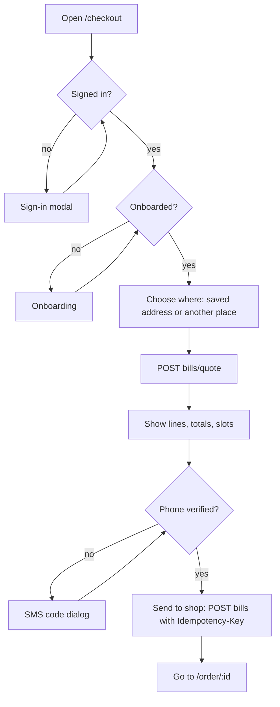

# 08 — Frontend design (Next.js, static export)

## 1. Stack (and nothing more)

| Need | Choice |
|---|---|
| Framework | **Next.js (App Router) + TypeScript (strict)**, `output: "export"` (static files) |
| Pages | Interactive pages are client components (`"use client"`). Server components only for layouts and build-time metadata. |
| Hosting | Cloudflare Pages (static, free) |
| Server state | TanStack Query v5 |
| Styling | Tailwind CSS v4 with CSS variables as design tokens |
| Icons | `lucide-react` (tree-shaken) |
| Class names | `clsx` |
| Tests | Vitest + Testing Library; Playwright for 5 smoke flows |

**Not allowed:** Redux / Zustand, form libraries, UI kits, date libraries (use `Intl`), chart libraries, axios.

**Next.js features we do NOT use** (they need a Next server, and our server is the Go API):
Server Actions, Route Handlers (`app/api/*`), `middleware.ts`, `cookies()` / `headers()`, ISR / `revalidate`, `next/image` optimisation (`images.unoptimized = true`; images are already resized at upload).

Bundle budget: customer first load < 180 KB gzip. Console, maps and Google sign-in scripts load only when needed.

## 2. Folder layout

```
web/
├── next.config.ts           output: "export" (production), trailingSlash: true, images.unoptimized
├── public/
│   ├── _headers             Security headers (CSP filled in after build, see §11.4)
│   ├── _redirects           GENERATED rewrites for id routes (see §11.2)
├── scripts/
│   ├── shop-slugs.mjs       Fetches active shop slugs for the build (§11.1)
│   ├── gen-redirects.mjs    Writes public/_redirects from the route folders (§11.2)
│   └── csp-hashes.mjs       Post-build: inline script hashes → out/_headers (§11.4)
└── src/
    ├── app/                 Routes only (thin)
    │   ├── layout.tsx       Root layout (server): <html>, fonts, <Providers>
    │   ├── providers.tsx    "use client": QueryClient, CartProvider, Toasts
    │   ├── not-found.tsx    "use client": renders the shop screen for new /s/<slug> (§11.1)
    │   ├── (customer)/      page.tsx (home), search/, s/[slug]/, checkout/, orders/, order/[id]/, account/, onboarding/
    │   └── console/         layout.tsx (guards), shop/[shopId]/…, driver/, admin/…, admin/shop/[id]/
    ├── components/ui/       Design system. Pure, no data fetching.
    ├── features/            Domain pieces: api hooks + components
    │   ├── auth/  onboarding/  home/  shop/  cart/  bill/  orders/
    │   └── console-shop/  driver/  admin/
    ├── lib/                 No React here (except hooks named use*)
    │   ├── api.ts           The ONE fetch wrapper
    │   ├── keys.ts          The ONE query-key factory
    │   ├── cartApi.ts       Cart service client (public key)
    │   ├── env.ts           Reads NEXT_PUBLIC_* once, typed
    │   ├── useRouteId.ts    Reads ids from the URL (§11.2)
    │   ├── money.ts  time.ts  safeUrl.ts  i18n.ts  usePolling.ts
    │   └── enums.gen.ts  errors.gen.ts  perms.gen.ts   GENERATED
    └── i18n/en.json
```

**Rules**
- `app/**/page.tsx` files are thin: they render one feature screen component. No logic, no fetching.
- `components/ui/` never imports from `features/` or `lib/api.ts`.
- `features/x/api.ts` holds every `useQuery` / `useMutation` for that feature. Components never call `fetch`.
- Put `"use client"` at the top of feature screens and interactive components — not on `layout.tsx` files that export `metadata`.
- No file over 200 lines. Split by component.

## 3. Design system (Airbnb-like: calm, white, round, clear)

### 3.1 Tokens (`components/ui/tokens.css`)

```css
:root {
  --c-bg: #ffffff;
  --c-surface: #f7f7f7;
  --c-text: #222222;
  --c-muted: #6a6a6a;
  --c-border: #dddddd;
  --c-accent: #0e7c66;        /* platform accent, NEXT_PUBLIC_ACCENT overrides */
  --c-accent-text: #ffffff;
  --c-danger: #c13515;
  --c-success: #008a05;
  --c-warning: #b45309;
  --c-shop: var(--c-accent);  /* set per shop page from shop.themeColor */
  --radius-card: 12px;
  --radius-input: 8px;
  --radius-pill: 999px;
  --shadow-card: 0 1px 2px rgb(0 0 0 / 0.08);
  --shadow-raise: 0 6px 16px rgb(0 0 0 / 0.12);
  --font: ui-sans-serif, system-ui, -apple-system, "Segoe UI", Roboto, "Noto Sans Sinhala", "Noto Sans Tamil", sans-serif;
}
```

- Type scale: 12 / 14 / 16 / 18 / 22 / 28 px. Body 16 px. Weights 400 and 600 only.
- Spacing: 4 px steps. Page max width 1120 px. 16 px side gutter on phones.
- Tap targets ≥ 44 px. Contrast AA.
- Shop theme color is used **only** for the shop header strip and the "Add" button on that shop's page. Text on it is checked for contrast (fallback to dark text).

### 3.2 Components (`components/ui/`)

| Component | Notes |
|---|---|
| `Button` | variants `primary`, `secondary`, `ghost`, `danger`; sizes `md`, `lg`; `loading` state |
| `IconButton` | always has `aria-label` |
| `Field` | label + hint + error text wrapper for any input |
| `Input`, `Textarea`, `Select`, `Switch`, `Checkbox` | controlled, `aria-invalid` on error |
| `Card` | 12 px radius, hover raise on desktop |
| `Badge` | status colors from one map `statusTone(status)` |
| `Price` | shows `formatLKR`, optional struck MRP and "Save Rs X" |
| `QtyStepper` | − qty + ; disables at `maxPerOrder` |
| `Sheet` | bottom sheet on mobile, side panel on desktop (cart, filters) |
| `Modal`, `ConfirmDialog` | focus trap, Esc to close |
| `Tabs`, `Chips` | category chips scroll horizontally |
| `Skeleton`, `Spinner`, `EmptyState`, `Banner`, `Toast` | |
| `DataTable` | console lists: columns config, row click, empty + loading states |
| `MiniBarChart`, `Sparkline`, `StatTile` | small SVG, no library |
| `MapPicker` | lazy; loads Google Maps only on mount |
| `SearchBar2Way` | the Airbnb-style pill: [Shop ▾] [What do you need?] [🔍] |

## 4. Pages and routes

### Customer

| Route | Screen | API calls |
|---|---|---|
| `/` | Home: search pill, shops near you, lowest prices, promos. "Near me" keeps a place rounded to 2 decimals (about 1 km) in `localStorage` key `gp_pin`; without it every active shop is listed. | `bootstrap` (once per app), `home` |
| `/search?q=&shop=` | Results. Searches while typing (300 ms pause, 2 letters at least, a newer search cancels the older). With `shop`, results can be added to the cart; without it they open the shop. | `search` (+ `home`, cached, for the shop names) |
| `/s/:slug` | Shop: header, buy-again row (signed in), category chips, product grid, sticky cart bar | `shop`, `products` (per category), `buy-again` |
| `/checkout` | Bill page: lines, substitution per line, address, slot picker, totals, phone verify, "Send to shop" | `quote`, then `bills` |
| `/orders` | My orders | `orders` |
| `/order/:id` | Timeline, lines, revision compare, coupon box, pay button, delivery code, report problem | `orders/{id}` + polling |
| `/onboarding` | Name → phone → address (3 steps) | `me`, `addresses` |
| `/account`, `/account/addresses` | Profile, addresses, sign out, delete account | |

Sign-in is a modal ("Continue with Google"), not a page. After sign-in the user returns to where they were (`safeNext`).

Route folders: `/s/:slug` = `app/(customer)/s/[slug]/page.tsx`, `/order/:id` = `app/(customer)/order/[id]/page.tsx`. How these work in a static export: §11.

### Console (`/console/...`, lazy chunk)

| Route | Who | Screen |
|---|---|---|
| `/console` | any member | Picks the right home by role. All console routes are client-only (§11.2). |
| `/console/shop/:shopId/orders` | owner, staff | Queue with tabs: New · Waiting · To pick · Packed · Out · Done. Asked again every 20 s while the tab is visible. A new bill rings a two-note chime made with the Web Audio API (no sound file); browsers need a tap first, so the queue has a sound switch. |
| `/console/shop/:shopId/order/:orderId` | owner, staff | Review panel / pick list / assign driver — buttons from `allowedActions` |
| `/console/shop/:shopId/products` | owner, staff | Table; the edit dialog shows only to owners and to staff with `canEditProducts`. Prices are typed in rupees and sent as exact cents. A connector-managed product only takes the order limit. |
| `/console/shop/:shopId/team` | owner | Members, invites. A new invite shows its link `https://<domain>/?invite=<token>` once (there is no e-mail sender). |
| `/console/shop/:shopId/dashboard` | owner, staff | Stat tiles + bar chart |
| `/console/shop/:shopId/payouts` | owner | Balance, history |
| `/console/driver` | drivers | Today's list → big "Enter code" / "Couldn't deliver" |
| `/console/admin` | admin | Dashboard |
| `/console/admin/shops`, `/console/admin/shop/:id?tab=profile\|settings\|hours\|slots\|fees\|payment\|connector` | admin | Shop setup as tabs, with a readiness checklist |
| `/console/admin/{catalog,sync-issues,coupons,orders,refunds,tickets,payouts,users,audit}` | admin | Lists + detail dialogs |

### 4.1 Sign-in, guards and onboarding

- **Sign-in modal** (`features/auth`): opened from the header, from a guard, or when a session is lost (the second `401` in `lib/api.ts`). Google's script loads only when the modal opens. The ID token goes to `POST /auth/google`; the answer (`me`) is written into the `bootstrap` cache.
- **Invite link:** `/?invite=<43-character token>` opens the modal by itself and sends the token as `inviteToken`. After a successful accept the token is removed from the address bar and the person goes to `/console`.
- **After sign-in:** a customer with an unverified phone goes to `/onboarding?next=<where they were>`. Team members skip onboarding. Nobody is forced through onboarding while only browsing; checkout (P30) sends them there.
- **Onboarding** shows only the steps still needed, fixed when it opens: name (confirm the Google name), phone (Turnstile, then the SMS code), first address (map pin; the answer says which shops deliver there; "Add it later" is allowed). It returns to `safeNext(next)`.
- **Guards** (`features/auth/guards.tsx`): `RequireUser` → `RequireRole` → `RequireTotp`. `/console` uses `ConsoleGate` (any team role). `/console/admin` adds `AdminGate` (super admin and a fresh authenticator code). Guards only decide what to show; the API checks every call again.
- **Authenticator setup:** the API returns an `otpauth://totp/…` link. The browser draws the QR itself (`lib/qr.ts`, byte mode, level M, up to 213 bytes, no library) and also offers the link for a phone. Anything that is not an `otpauth://totp/` link is never drawn or linked.
- **Account:** name (editable), e-mail (fixed), phone (a new SMS code changes it), up to 5 addresses, sign out here or everywhere. **Delete account** is a soft delete (`DELETE /me`, docs/06 section 5): the person types `DELETE`, the API refuses with `ACCOUNT_NOT_DELETABLE` and the page lists every reason (order or unpaid bill open, refund not paid out, shop team member). The cart is in the cart service, so the web app checks it itself and refuses first (`useCartReasons`, filled in by the cart screens in P29).
- **Third-party scripts** are loaded through `lib/loadScript.ts` with fixed addresses: Google Identity Services, Google Maps and Cloudflare Turnstile.

## 5. Data rules (fewer API calls, no duplication)

1. **One fetch wrapper** (`lib/api.ts`): adds `credentials: "include"`, `X-Requested-With: gp-web`, JSON, `Idempotency-Key` when asked, maps error JSON to `ApiError{code, message, fields}`. On `401` it calls `/auth/refresh` **once**, then retries; second `401` → sign-in modal.
2. **One query-key factory** (`lib/keys.ts`): `keys.shop(slug)`, `keys.products(slug, cat)`, `keys.order(id)` … No inline arrays.
3. **Stale times:**

| Data | `staleTime` |
|---|---|
| bootstrap / me | 5 min |
| home, shop, products, categories | 60 s |
| slots | 30 s |
| order detail | 0 (polled while active) |
| console lists | 15 s (polled 20 s while visible) |

4. **Mutations write the server response into the cache** (`setQueryData`) instead of refetching. The API returns the full updated object for this reason.
5. **No `fetch` in `useEffect`.** All server state goes through TanStack Query.
6. **Polling** only through `usePolling(key, { every: 20000, while: isActive })`: stops when the tab is hidden, when the order is final, and after 30 min.
7. **Search** debounced 300 ms, min 2 characters, cancels the previous request.
8. **Bill quote** is called on page open and when address or slot changes — not on every render.
9. **Buttons come from `allowedActions`.** The UI never decides from `status` what is allowed (D29).
10. **Errors:** `errors.gen.ts` maps codes to messages. Field errors go next to the field.

## 6. Cart (cart service)

- `CartProvider` keeps `{ shopId, tenantId, publicKey, cartId }` in `localStorage` key `gp_cart` (no personal data).
- Adding an item from another shop → `SwitchShopDialog`: "Your cart has items from Krishna Super. Clear it and start a new cart?"
- Quantity taps are optimistic and **debounced 400 ms per line** → one cart call per burst.
- Cart prices are labelled "estimate"; the bill page shows server prices.
- If the cart service fails: toast "Can't update cart, try again", the UI rolls back.
- One cart holds one shop. A tap on a product of another shop, while the cart has items, opens `SwitchShopDialog`; if the person agrees the old cart is discarded and a new one is started for the new shop. An empty old cart is replaced without asking.
- Writes go one at a time (a small queue), so two calls never race on one cart. A cart the service no longer knows (`404`) is forgotten, and the next tap starts a new one.
- The cart lives in the cart service, so only the web app can tell that it has items. `useCartReasons` uses this to stop "Delete account" (FR-AUTH-09).

## 7. Bill page flow



**Where to deliver.** The main address is chosen at first. The person can pick another saved address, or "Another place": a street line, a landmark, an optional name and a map pin, for this order only (FR-BILL-10). That place is sent as `destination` instead of `addressId`, is never added to the address book, and is asked for after a 600 ms pause so the bill is not requested on every letter. A person with no saved address gets "Another place" at once.

**When the bill is asked for again.** On open, and when the place, the delivery window or the cart changes. A change of "if it is out of stock" does not ask again; it travels with "Send to shop". The `Idempotency-Key` is made when "Send to shop" is pressed and kept for the same bill, so a retry after a network error cannot create two orders; a changed bill gets a new key.

**Why "Send" is off.** The page lists what the person can fix: shop closed, place out of range, below the minimum order, unavailable items in the cart, no window chosen, phone not verified (the verify card is shown). The server checks everything again on submit.

## 8. Payment button

0. The button exists only when `allowedActions` has `PAY`. Every other order button (cancel, accept changes, coupon, report a problem) works the same way (XSS-05, D29).
1. `POST /orders/{id}/payment` with an `Idempotency-Key`.
2. PayHere: check `isAllowedPayHereAction(action)` (only `https://sandbox.payhere.lk/pay/checkout` or `https://www.payhere.lk/pay/checkout`), build a hidden `<form method="post">` with `document.createElement` (never `innerHTML`), submit.
3. Return page shows "Confirming payment…" and polls the order until `PAID` (or 3 min → "We'll update you by SMS").
4. Manual: show bank details card with copy buttons and the order code as reference.

### Driver screen (`/console/driver`)

- One list for today (Colombo date), grouped by slot; courier orders sit in their own group. It is asked again every 20 s while the page is visible.
- Each card has a call link (digits and `+` only, helper `lib/contact.ts`) and a map link from the pin. "Enter code" and "Couldn't deliver" show only while the status is `OUT_FOR_DELIVERY`.
- Code sheet: one big numeric box, 4 digits, other characters dropped. The API does not send a try count, so the screen counts the wrong codes it saw (kept per card, not per sheet) and shows "N tries left". After 5, or on `423 DELIVERY_CODE_LOCKED`, the box is off and the text says to ask the shop or admin. The server stays the judge; a reload forgets the count.
- "Couldn't deliver" needs a note of 3 to 300 characters. A stale or missing order (`409`, `404`) asks for the list again.
- The numbers at the bottom are `GET /driver/stats` for today and for the last 7 days.

### Admin screens (`/console/admin/…`)

- One menu (`features/admin/sections.ts`) lists the admin pages; each part of P33 adds its lines. Every admin call goes through `adminCall` / `useAdminQuery` / `useAdminMutation` (`features/admin/api.ts`), which add the `/admin` prefix and ask lists again after a change.
- **Shop setup** `/console/admin/shop/:id?tab=…`: profile, settings (with the cart-service card), hours, slots, fees (with a fee preview), payment. The readiness card on top lists what is missing and links to the tab that fixes it; the "taking orders" switch stays off until nothing is missing (the API checks again).
- **Secrets are write-only.** The PayHere merchant secret is a password box that is sent once and emptied after the save; the list only shows "Secret saved" (`hasSecret`). The cart card shows the public key only.
- Money is typed in rupees and sent as exact cents (`parseRupees`); km and kg use at most 2 decimals (`parseDec2`). Times are Sri Lanka time; "24:00" is allowed only as a closing time.
- **Connector wizard** (the shop's `connector` tab): connect → test → table → map → preview → switch on → trigger secret. The connection string goes in a password box that is emptied as soon as it is sent; only the masked host comes back. The trigger secret is shown once in a window and dropped from memory when it closes. Run errors are one of three fixed words; text from the shop's database is never shown. `/console/admin/sync-issues` lists rows with no match (link, add, ignore) and held prices (use new, keep current, ignore); a price of 0 cannot be approved.
- The shop logo is a link to an image on our image host for now; picture upload through `POST /uploads/presign` is not built yet.

## 9. Frontend security rules

| Rule | How |
|---|---|
| No HTML injection | Never use `dangerouslySetInnerHTML` (ESLint `react/no-danger` = error). All text rendered as text. |
| No tokens in JS | Auth is `HttpOnly` cookies. `localStorage` holds only cart ids and UI prefs. |
| Safe links | External links `rel="noopener noreferrer"`. Only `https:` URLs rendered as links/images (`safeUrl`). |
| Safe redirects | `safeNext(next)` allows only paths starting with `/` and not `//`. |
| CSP and headers | `web/public/_headers` + post-build script hashes (§11.4, `10-security.md` §5). |
| Third-party scripts | Only Google Identity Services, Google Maps and Cloudflare Turnstile (the phone bot check), loaded on demand. |
| Images | Only from `img.<domain>` and Google Maps tiles. |
| Input | `maxLength` on every input matching the API limit. |

## 10. Accessibility and language

- Every icon button has `aria-label`. Dialogs trap focus. Status changes announced with `aria-live="polite"`.
- All text from `i18n/en.json` (`t('bill.sendToShop')`). Adding `si.json` / `ta.json` later needs no code change.
- Numbers and dates with `Intl` in `en-LK`, time zone `Asia/Colombo`.

## 11. Next.js static export: how dynamic pages work

We build plain HTML/JS files once and serve them from Cloudflare Pages. No Next server runs. Three kinds of routes:

| Kind | Examples | How |
|---|---|---|
| Fixed | `/`, `/search`, `/checkout`, `/orders`, `/console/admin` | Normal static pages |
| Public with a known list | `/s/[slug]` (shop pages) | Pre-built for every active shop at build time; brand-new shops served by `not-found.tsx` until the rebuild (§11.1) |
| Private, unknown ids | `/order/[id]`, `/console/shop/[shopId]/…`, `/console/admin/shop/[id]` | One placeholder page + Cloudflare rewrite (§11.2) |

### 11.1 Shop pages: pre-built + rebuild webhook

- `app/(customer)/s/[slug]/page.tsx` has `generateStaticParams()` that returns all active shop slugs (from `GET /v1/shops?fields=slug`, called by `scripts/shop-slugs.mjs` at build time).
- Each shop page gets a real `<title>`, description and Open Graph image at build time, so links shared on **WhatsApp / Facebook show the shop name and logo**.
- The page body is a client component that loads products from the API (prices are always live).
- **Webhook:** when the admin creates a shop or changes its slug, name or logo, the API calls the **Cloudflare Pages deploy hook** (D30). The new build is live in about 1–3 minutes.
- **Before that build is live**, `/s/<new-slug>` has no file, so Cloudflare serves `404.html`. Our `app/not-found.tsx` is a client component: if the path is `/s/<slug>`, it renders the normal shop screen (data comes from the API). So a new shop works **immediately**; only its link preview waits for the build.
- There is **no rewrite rule for `/s/*`** — Cloudflare applies `_redirects` rules even when a file exists, so a catch-all would hide the pre-built pages.

### 11.2 Private id pages: placeholder + rewrite

- Detail pages use a **singular path** so they never clash with list pages:
  `/order/:id` (list is `/orders`), `/console/shop/:shopId/order/:orderId` (list is `/console/shop/:shopId/orders`).
- Each id route exports `generateStaticParams` returning only the placeholder `_` (one HTML file).
- `public/_redirects` is **generated** by `scripts/gen-redirects.mjs` from the route folders. One rule per id route, using Cloudflare placeholders (`:name` = one path segment), with and without the trailing slash. Status `200` = rewrite (the browser keeps the real URL):

```
/order/:id                                   /order/_/                                  200
/order/:id/                                  /order/_/                                  200
/console/shop/:shopId/orders                 /console/shop/_/orders/                    200
/console/shop/:shopId/orders/                /console/shop/_/orders/                    200
/console/shop/:shopId/order/:orderId         /console/shop/_/order/_/                   200
/console/shop/:shopId/order/:orderId/        /console/shop/_/order/_/                   200
/console/admin/shop/:id                      /console/admin/shop/_/                     200
/console/admin/shop/:id/                     /console/admin/shop/_/                     200
…one pair per id route (Cloudflare allows 100 dynamic rules; we need about 20)
```

- Admin shop setup is **one page with tabs** (`?tab=settings`), not one route per tab — fewer rules.
- **Read ids with `useRouteId()`**, which parses `usePathname()`. **Never use `params`** in these pages — after a rewrite, `params` is `"_"`.
- These pages are private: no SEO, no metadata.
- `P06` must check these rewrites on a real Cloudflare Pages preview deploy before more pages are built.

### 11.3 Local development

- `next.config.ts` sets `output: "export"` **only for `next build`**. In `next dev`, dynamic routes behave normally, so `/orders/<real id>` works locally.
- Dev server: `http://localhost:3000`.

### 11.4 Strict CSP with a static export

- The App Router puts small **inline `<script>` tags** in every HTML page. A strict CSP (`script-src 'self'`) would block them, and we cannot use per-request nonces without a server.
- So after `next build`, `scripts/csp-hashes.mjs`:
  1. reads every `out/**/*.html`,
  2. collects the SHA-256 hash of each inline script,
  3. writes one `_headers` rule per page with `script-src 'self' 'sha256-…' …` (plus the allowed Google hosts).
- Cloudflare `_headers` limits (checked by `csp-hashes.mjs`, the build fails if exceeded): **100 rules**, **2,000 characters per line**, one `*` per pattern. A page that Cloudflare rewrites (`/order/:id`) gets its rule under the **rewrite's** pattern, because headers match the real URL, not the file. Every page rule starts with `! Content-Security-Policy` so it replaces the fallback rule on `/*` (that fallback holds the hashes of `404.html`, which serves new shop pages). Many shops mean many rules: with a lot of pre-built shop pages, this is the limit you will meet first.
- No `'unsafe-inline'` for scripts. Check after deploy: browser console shows **no CSP errors** on every page, and each header line stays under Cloudflare's header size limit.
- The build fails if any inline script has no hash.

### 11.5 Checklist for every new page

- [ ] `page.tsx` is thin and renders one screen component.
- [ ] Screen component starts with `"use client"`.
- [ ] Ids come from `useRouteId()`, not `params`.
- [ ] Id routes use a singular path; `npm run gen:redirects` re-run; private routes sit under `console/` (guarded).
- [ ] Data through `features/*/api.ts` hooks only.
