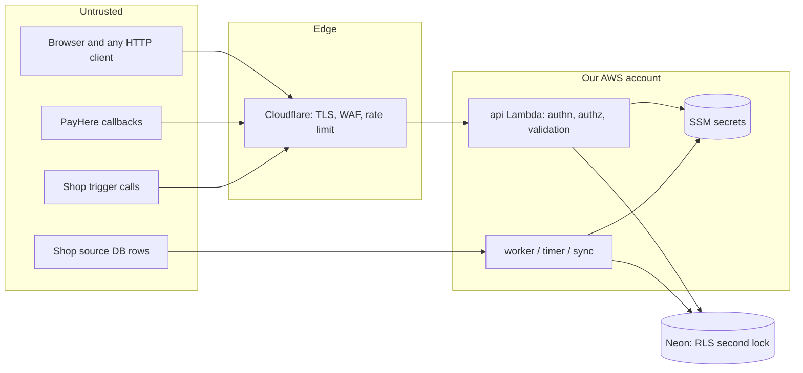

# 10 — Security design

**Principle:** the browser, the shop's database, PayHere callbacks and every request body are **untrusted**. The server re-checks everything, every time.

The step-by-step vulnerability checklist (with tests and tools) is `11-security-audit.md`.

## 1. What we protect

| Asset | Why it matters |
|---|---|
| Money: order totals, payment status, ledger, payouts | Fraud, losses |
| Customer data: phone, address, location, order history | Privacy law, trust |
| Accounts and sessions (especially super admin) | Full control of the platform |
| Secrets: PayHere secrets, platform cart key, SMS key, DB passwords, encryption key | Lets an attacker act as us |
| Shop data: prices, sales, connector access to the shop DB | Business secrets, the shop's own system |
| SMS balance | SMS pumping costs real money |

## 2. Trust boundaries



Every arrow into "Trusted" is checked: identity (cookie / signature), permission + scope, input shape and size, business rules.

## 3. Threat model (STRIDE)

| Threat | Example | Main controls |
|---|---|---|
| **Spoofing** | Fake PayHere "paid" call; stolen session; someone else's Google token | `md5sig` check + amount check; `HttpOnly` cookies + refresh rotation + reuse detection; Google `aud` check; admin TOTP |
| **Tampering** | Change price / total in the request; edit PayHere form amount; poisoned prices from shop DB | Server-side pricing only; unknown fields rejected; notify amount check; sync price holds |
| **Repudiation** | "I never approved that refund" | `audit_log` + `order_events` (append-only), actor + role + time |
| **Information disclosure** | Read another customer's order; see another shop's sales; secrets in logs | Scope checks + RLS; `404` for other shops; log redaction; secrets only in SSM |
| **Denial of service** | Flood bills, SMS pumping, huge bodies | Cloudflare rate limit, API Gateway throttle, body limits, reserved concurrency, SMS caps, Turnstile on OTP |
| **Elevation of privilege** | Staff makes themselves owner; customer calls admin route | Permission map; owner-only team actions; admin needs `SUPER_ADMIN` + TOTP; role cannot be set from request bodies |

## 4. Controls by area

### 4.1 Identity and sessions

| Control | Detail |
|---|---|
| Google only | No passwords to leak. `email_verified` required. `sub` is the identity key. |
| Access token | JWT HS256 (alg pinned), 15 min, claims: `sub`, `sid`, `totp`, `iat`, `exp`, `iss`, `aud`. Key from SSM (`/…/jwt/key`, 32+ random bytes). |
| Refresh token | 32 random bytes, stored as SHA-256 hash, 30 days, rotated each use. Reuse → revoke the family. |
| Cookies | `gp_at`: `HttpOnly; Secure; SameSite=Lax; Path=/`. `gp_rt`: same + `Path=/v1/auth`. Host-only on `api.<domain>`. |
| Admin | Email in `SUPER_ADMIN_EMAILS` **and** `SUPER_ADMIN` membership **and** TOTP for the session. TOTP step reuse blocked (`last_used_step`). |
| Invites | 32-byte token, hashed, 7 days, single use, Google email must match. |
| Blocking | `users.status = BLOCKED` → all sessions revoked, sign-in refused. |

### 4.2 Authorization

- Every route declares its guard in `routes.go` (`public`, `user`, `perm:…`, `admin`, `sig`). A test fails if a route has no guard.
- Permissions come from the generated map. Shop permissions need an **active membership for the `{shopId}` in the path**.
- Services take a `Scope` and **always** filter by it; RLS repeats the check in Postgres.
- Resource not in scope → `404 NOT_FOUND` (not `403`) so ids cannot be probed.
- Request bodies never carry `role`, `status`, `price`, `total`, `shopId` for the caller's own scope, or `customerId`. These come from the server.

### 4.3 Input and output

| Control | Detail |
|---|---|
| JSON decode | 64 KB limit, `DisallowUnknownFields`, one JSON value only |
| Validation | Every string has a max length (matching the DB `CHECK`); numbers have ranges; enums checked against generated lists; phones normalised to `+94XXXXXXXXX` |
| SQL | `pgx` parameters only. Identifiers (connector) via `pgx.Identifier` after an allow-list check against `information_schema` |
| Output | JSON only, `Content-Type: application/json; charset=utf-8`, `X-Content-Type-Options: nosniff` |
| Frontend | React escaping only; `dangerouslySetInnerHTML` banned by lint; URLs filtered by `safeUrl` |

### 4.4 Data protection

| Data | Protection |
|---|---|
| Delivery code, admin TOTP secret | AES-256-GCM with `APP_ENC_KEY` (SSM) |
| OTP codes | HMAC-SHA256 with `OTP_PEPPER` (SSM), compared in constant time |
| Refresh, invite tokens | SHA-256 hash only |
| Connection strings, PayHere secrets | SSM `SecureString` only; never in the DB, never returned by the API |
| Card data | Never received except PayHere card fields in notify → dropped before saving |
| Logs | Redacted (phones, emails, tokens, codes); IPs stored only as HMAC hash |
| At rest | Neon, SSM, S3/R2 encrypt at rest |
| In transit | TLS everywhere; DB `sslmode=require`; HSTS on web and API |

**Privacy (Sri Lanka Personal Data Protection Act):** collect only name, phone, address and pin; say why in the privacy page; allow account deletion (`DELETE /me`); keep finance records as required; a contact for data requests.

### 4.5 Payments

- Amount, currency and order come from **our** database, signed by the server-side hash.
- Paid **only** after the notify checks in `09-integrations.md` §2.3.
- Every payment attempt has its own id; duplicate notifies do nothing.
- Late or extra payments create a refund request automatically.
- Admin manual "mark paid" requires a reference and is audit-logged.

### 4.6 Abuse and business logic

| Abuse | Control |
|---|---|
| Fake / prank orders | Phone verified before first bill; max **3 open unpaid orders** per customer; 10 bills / hour; shop can reject; admin can block user |
| SMS pumping | Turnstile token on `POST /me/phone/send`; 3 / hour / user, 5 / day / phone; Sri Lankan numbers only (`+94`); global daily cap with alert |
| Slot hoarding | Slot held only while order is waiting; timers release it; open-unpaid limit |
| Coupon abuse | Per-user limit, total limit, atomic reserve, case-insensitive single code, 10 tries / hour |
| Delivery code guessing | 5 tries then lock; code only visible to the customer |
| Connector misuse | Admin only, TOTP; host SSRF checks; read-only connection; row and time limits |
| Trigger URL abuse | HMAC + 5-minute timestamp window + rate limit; only queues a sync |

### 4.7 Infrastructure

| Control | Detail |
|---|---|
| IAM per function | `api`: SSM read `/<app>/<env>/*` (+ write for connector and payment secrets), SQS send, Scheduler create, Lambda invoke `sync`. `worker`: SSM read, SQS consume, Scheduler create. `timer`: SSM read. `sync`: SSM read. No `*` actions. |
| Scheduler role | Can invoke only `timer`, `sync` and `worker`. |
| Lambda env | Holds SSM **names**, never secret values. |
| DB role | App uses `app_rw` (RLS applies). Owner role only in CI migrations. |
| Network | No VPC needed; Neon and APIs over TLS. |
| Limits | API Gateway throttle 50 rps / burst 100; reserved concurrency per function (`04-architecture.md`). |
| Edge | Cloudflare proxy on `api` and `www`: TLS 1.2+, "Always use HTTPS", WAF managed rules (free set), 1 rate-limit rule. |

### 4.8 Monitoring and response

| Alarm | Trigger |
|---|---|
| API errors | 5xx > 1% for 5 min |
| DLQ | any message |
| Payment signature failures | ≥ 3 in 1 hour |
| Refresh-token reuse | any |
| SMS cap | 80% of daily cap |
| Sync failing | 3 failed runs in a row |
| Admin sign-in | every admin sign-in sends an SMS to the admin phone |

The template turns these structured log messages (`msg` field) into the alarm metrics. The code must log them exactly:

| Alarm | Log `msg` | Written by |
|---|---|---|
| Payment signature failures | `payment.signature_invalid` | `api` |
| Refresh-token reuse | `auth.refresh_reuse` | `api` |
| SMS cap | `sms.cap_80pct` (once, when 80% is crossed) | `api`, `worker` |
| Sync failing | `sync.run_failed` (alarm: 3 in 30 minutes, since a metric cannot count "in a row") | `sync` |

**If something goes wrong:** pause the shop (`accepting_orders = off`), rotate the affected secret in SSM (functions pick it up within 5 min), revoke sessions (`UPDATE sessions SET revoked_at = now()`), check `audit_log`, tell affected users.

## 5. HTTP security headers

**Web** — `web/public/_headers` (Cloudflare Pages). Domains are filled from env at build time. The `script-src` line below is the **base**; after `next build`, `scripts/csp-hashes.mjs` writes one rule per page that adds the `sha256-…` hash of every inline Next.js script on that page (see `08-frontend-design.md` §11.4).

```
/*
  Strict-Transport-Security: max-age=31536000; includeSubDomains
  X-Content-Type-Options: nosniff
  X-Frame-Options: DENY
  Referrer-Policy: strict-origin-when-cross-origin
  Permissions-Policy: camera=(), microphone=(), geolocation=(self), payment=()
  Cross-Origin-Opener-Policy: same-origin-allow-popups
  Content-Security-Policy: default-src 'self'; script-src 'self' https://accounts.google.com/gsi/client https://maps.googleapis.com https://maps.gstatic.com; style-src 'self' 'unsafe-inline' https://accounts.google.com/gsi/style https://fonts.googleapis.com; img-src 'self' data: https://img.nearshop.lk https://maps.gstatic.com https://maps.googleapis.com https://*.ggpht.com https://lh3.googleusercontent.com; font-src 'self' https://fonts.gstatic.com; connect-src 'self' https://api.nearshop.lk https://api.cart.example.com https://maps.googleapis.com https://places.googleapis.com https://accounts.google.com/gsi/ https://*.r2.cloudflarestorage.com https://challenges.cloudflare.com; frame-src https://accounts.google.com/gsi/ https://challenges.cloudflare.com; form-action 'self' https://sandbox.payhere.lk https://www.payhere.lk; frame-ancestors 'none'; base-uri 'self'; object-src 'none'; upgrade-insecure-requests
```

- `style-src 'unsafe-inline'` is needed by Google sign-in, Maps and Next.js. Scripts stay strict: no `unsafe-inline`, no `unsafe-eval` — Next.js inline scripts are allowed **only by hash**.
- `form-action` allows only PayHere for the payment form.
- Check Google's current CSP guidance for Identity Services and Maps before go-live; test with the browser console for CSP errors.

**API** — set by `httpx` on every response:

```
Content-Type: application/json; charset=utf-8
X-Content-Type-Options: nosniff
Strict-Transport-Security: max-age=31536000; includeSubDomains
Cache-Control: private, no-store            (unless the route is public-cacheable)
Access-Control-Allow-Origin: <exact allowed origin>   (never *)
Access-Control-Allow-Credentials: true
Vary: Origin
```

## 6. Secrets list

| Name (`/<app>/<env>/…`) | Used by | Rotate |
|---|---|---|
| `jwt/key` | api | yearly or on incident (signs everyone out) |
| `enc/key` (`APP_ENC_KEY`, 32 bytes) | api, worker | on incident; keep old key id for decrypting |
| `otp/pepper` | api | on incident |
| `ip/pepper` | api | yearly |
| `cart/platform-key` | api, worker | on incident |
| `payhere/<accountId>` | api | when PayHere rotates |
| `sms/api-key`, `whatsapp/token` | worker | per provider rules |
| `connectors/<id>` | sync | when the shop changes its password |
| `connectors/<id>/trigger` | api | admin "rotate" button |
| `r2/keys` | api | yearly |
| `pages/deploy-hook` | worker | if leaked (re-create hook in Cloudflare) |
| `db/url` (`app_rw`, pooled) | all | on incident |
